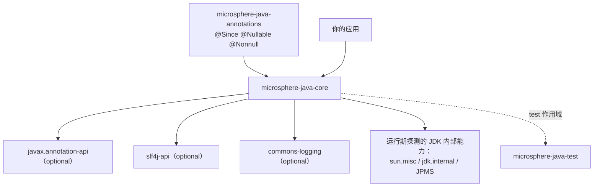

# `microsphere-java-core` 包分组索引（用户文档）

模块：`io.github.microsphere-projects:microsphere-java-core` · 源码线：`release` 分支，`0.3.20-SNAPSHOT`
Java 级别：按 **Java 8** 编译，CI 在 JDK 8 / 11 / 17 / 21 / 25 上验证 · 编译依赖：仅 `microsphere-java-annotations`

`core` 包含 34 个包、686 个 main 源文件类型，因此按顶层包分组拆成 14 篇。请先用下表定位所需分组；
每篇的中文版都在同目录的 `zh/` 子目录中（本索引的英文版在 [../README.md](../README.md)）。

---

## 1. `core` 的依赖

正是这些 optional 集成与「JDK 内部能力」这条边，产生了各页面中的**兼容范围**说明：库在运行期探测 classpath 与 JDK，
能力缺失时退回到可移植路径。

---

## 2. 页面与包覆盖

| # | 页面 | 覆盖的包（main 源码） | 类型数 |
|---|------|------------------------|--------|
| 1 | [工具类、常量与文本](util-and-constants.md) | `io.microsphere.util`、`io.microsphere.util.jar`、`io.microsphere.constants`、`io.microsphere.text`、`io.microsphere.misc` | 45 |
| 2 | [集合与过滤器](collections-and-filters.md) | `io.microsphere.collection`、`io.microsphere.filter` | 41 |
| 3 | [语言抽象](language-abstractions.md) | `io.microsphere.lang`、`io.microsphere.lang.function`、`io.microsphere.lang.invoke`、`io.microsphere.invoke` | 18 |
| 4 | [反射、类型与 JavaBean](reflection-and-beans.md) | `io.microsphere.reflect`、`io.microsphere.reflect.generics`、`io.microsphere.internal.reflect`、`io.microsphere.beans` | 26 |
| 5 | [类型转换](type-conversion.md) | `io.microsphere.convert`、`io.microsphere.convert.multiple` | 52 |
| 6 | [序列化](serialization.md) | `io.microsphere.io.serializer` | 18 |
| 7 | [事件分发](events.md) | `io.microsphere.event` | 10 |
| 8 | [I/O、NIO、扫描与文件过滤](io-and-scanning.md) | `io.microsphere.io`、`io.microsphere.io.event`、`io.microsphere.io.scanner`、`io.microsphere.io.filter`、`io.microsphere.nio.file`、`io.microsphere.nio.charset` | 21 |
| 9 | [网络与 URL 协议](net-and-url-protocols.md) | `io.microsphere.net`、`io.microsphere.net.classpath`、`io.microsphere.net.console` | 13 |
| 10 | [日志](logging.md) | `io.microsphere.logging` | 9 |
| 11 | [类加载与构件探测](classloading-and-artifacts.md) | `io.microsphere.classloading` | 16 |
| 12 | [JSON](json.md) | `io.microsphere.json` | 8 |
| 13 | [配置属性元数据](configuration-metadata.md) | `io.microsphere.metadata` | 9 |
| 14 | [并发、进程、管理与安全](concurrency-process-and-management.md) | `io.microsphere.concurrent`、`io.microsphere.process`、`io.microsphere.management`、`io.microsphere.management.builder`、`io.microsphere.security` | 23 |

> [!NOTE]
> 表中「类型数」取自 `release` 分支的 main 源文件数量；当一个文件内声明多个类型时，页面实际描述的类型数可能略少。

---

## 3. 建议阅读顺序

**日常工具类使用** → 1 → 2 → 5 → 4
**构建可插拔子系统** → 3（`Prioritized`、`Wrapper`）→ 7（事件）→ 再看 5、6、10、11、13、14 各页的 SPI 小节
**与 classpath 打交道** → 1（资源/服务加载）→ 8（扫描）→ 9（URL 协议）→ 11（构件探测）
**IDE 友好的配置元数据** → 4（`ConfigurationProperty`）→ 13 → 以及[注解处理器页面](../zh/microsphere-annotation-processor.md)
**JDK 17+ / 21+ / 25 迁移** → 11、14、8，以及 4、6 中的 JDK 矩阵

---

## 4. 整个模块的版本信息

| 版本线 | `core` 状态 | 说明 |
|--------|-------------|------|
| `0.1.x` – `0.2.x` | 历史 | 包结构仍在演进；`io.microsphere.lang` 与 `io.microsphere.invoke` 在该阶段加入。单个 API 的 `@Since` 取值可追溯到这些版本线，详见各页兼容表。 |
| `0.3.x`（当前线，已发布至 `0.3.19` / 源码为 `0.3.20-SNAPSHOT`） | 活跃 | 公共 API 趋于稳定；全模块补齐 `@Nonnull` / `@Nullable` 契约，并完成空值安全降级修复。 |
| `1.x` | 不存在 | 本仓库没有 `release-1.x` 分支，因此不生成 `docs/1.x/` 文档。 |

`0.3.x` 内的二进制兼容策略：public 与 protected 签名视为 API；新增能力以 `@Since` 标注版本；行为变更会在所属页面写明，不做静默修改。
