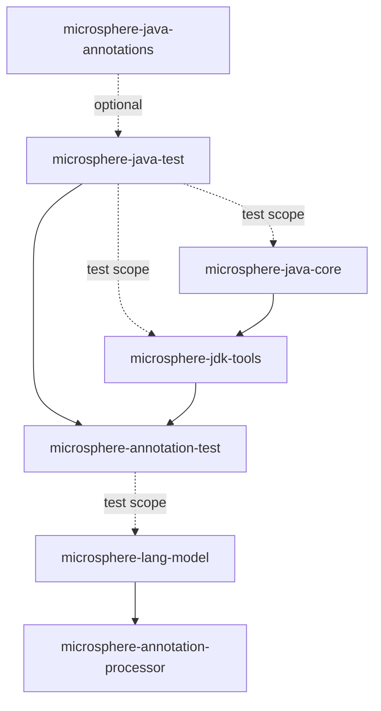
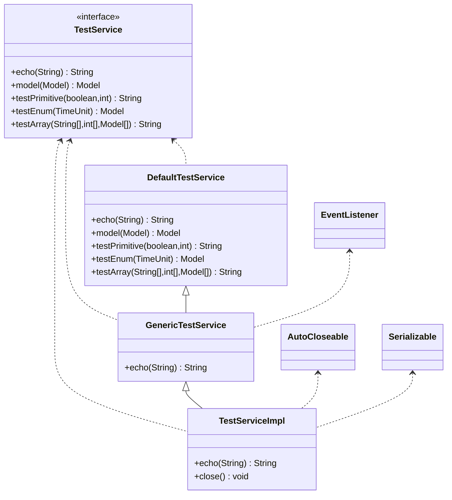

# Microsphere Java Test

| | |
|---|---|
| **Artifact** | `io.github.microsphere-projects:microsphere-java-test` (`0.3.20-SNAPSHOT`, `release` branch) |
| **Packages** | `io.microsphere.test.annotation` (1 type) · `io.microsphere.test.model` (11 types) · `io.microsphere.test.service` (4 types) — 16 main-source types, no other code |
| **Contents** | 1 annotation interface + 1 interface + 1 enum + 13 classes (one of them, `StringArrayList`, extends `ArrayList<String>`) = 16 types; 14 JUnit 5 test classes |
| **JDK level** | No `maven.compiler.*` / `<release>` property exists anywhere in the reactor — the bytecode level is inherited from the external parent `microsphere-build:0.3.16` (`pom.xml:6-10`); CI-tested on JDK 8 / 11 / 17 / 21 / 25 (Temurin) |
| **In-repo compile dependency** | `io.github.microsphere-projects:microsphere-java-annotations`, declared `optional` (`microsphere-java-test/pom.xml:24-29`) |
| **Other declared dependencies** | `junit-jupiter`, `junit-jupiter-engine`, `mockito-core`, `logback-classic`, `javax.ws.rs-api`, `jaxws-api`, `spring-context`, `spring-web` — **every one `optional`, none with `<scope>test</scope>`** (`microsphere-java-test/pom.xml:31-84`) |
| **Shipped resources** | `src/main/resources/junit-platform.properties`, `src/main/resources/logback-test.xml` — both land inside the jar and on consumers' test classpaths |

> [!NOTE]
> **Citation shorthand used on this page.** Paths are relative to `microsphere-java-test/src/main/java/io/microsphere/`
> for module sources (`test/model/Model.java:29`), and to `microsphere-java-test/src/test/java/io/microsphere/` for its
> own tests (`test/model/ModelTest.java:23`). Cross-module paths are written in full
> (`microsphere-java-core/pom.xml:66-71`).

This module is the **shared fixture layer** of Microsphere Java. It publishes sixteen deliberately boring types — a
POJO inheritance chain, a set of "one field per type kind" models, an enum, a reflection-heavy annotation, and a
small service interface hierarchy — whose only job is to give the *other* modules something stable and non-trivial to
reflect over, compile against, and annotation-process. Nothing here is a production API, and nothing here has logic:
every method is a getter, a setter, or a one-line stub.

**Reach for this artifact when** you are writing tests for Microsphere itself (or for a project that reuses its
fixtures) and you need a type shape that exercises a code path — `Model extends Parent extends Ancestor` to test
hierarchical field walking, `CollectionTypeModel` to test generic-component resolution, `TestAnnotation` to test
annotation-attribute resolution across all eight member types. Adding the jar should cost nothing at runtime, because
none of its types is ever loaded by production code.

---

## 1. What this module is for, and who consumes it

| I want to test… | Fixture | Why that fixture |
|---|---|---|
| Walking fields up a class hierarchy | `test/model/Ancestor.java:27`, `test/model/Parent.java:25`, `test/model/Model.java:29` | Three-level chain `Model → Parent → Ancestor`, one field per level (`z` / `b,s,i,l` / `f,d,tu,str,bi,bd`) |
| Resolving primitive-typed fields | `test/model/PrimitiveTypeModel.java:25` | All eight primitives, getters only — no setters (`test/model/PrimitiveTypeModel.java:43-73`) |
| Resolving boxed/"simple" types incl. `Void` | `test/model/SimpleTypeModel.java:29` | `Void`, `Boolean`, `Character`, …, `BigDecimal`, `BigInteger`, `java.util.Date` |
| Component types of `Collection` generics | `test/model/CollectionTypeModel.java:31` | `Collection<String>`, `List<Color>`, `Queue<PrimitiveTypeModel>`, `Deque<Model>`, `Set<Model[]>` |
| Key/value types of `Map` generics | `test/model/MapTypeModel.java:31` | `Map`, `SortedMap`, `NavigableMap`, `HashMap`, `TreeMap` — declared types vary on purpose |
| Array component types | `test/model/ArrayTypeModel.java:25` | `int[]`, `String[]`, `PrimitiveTypeModel[]`, `Model[]`, `Color[]` |
| A parameterized *supertype* | `test/model/StringArrayList.java:29` | `extends ArrayList<String>` — the type argument is fixed by inheritance, not by a field |
| Enum constants with state | `test/model/Color.java:25` | `RED(1)`, `YELLOW(2)`, `BLUE(3)` + `getValue()` + overridden `toString()` |
| Reading annotation member values reflectively | `test/annotation/TestAnnotation.java:43` | One attribute per supported member type (`test/annotation/TestAnnotation.java:45-71`) |
| Configuration-metadata extraction | `test/model/ConfigurationPropertyModel.java:29` | Five fields each carrying `@ConfigurationProperty(name = …)` |
| Interface + impl + proxy resolution | `test/service/TestService.java:36`, `test/service/TestServiceImpl.java:77` | JAX-RS, Spring and JAX-WS annotations stacked on one type |

Four reasons the fixtures live in their own module rather than being duplicated into each consumer's `src/test`:

1. **The same type shape must be assertable from two different vantage points.** `microsphere-java-core` reflects on
   these classes at *runtime*; `microsphere-lang-model` and `microsphere-annotation-processor` inspect the *same*
   classes as `TypeElement`/`DeclaredType` objects inside `javac`. A private copy in each test tree would make those
   two views incomparable.
2. **All dependencies are `optional`, so the consumer's versions win.** The module asks for JUnit, Mockito, Logback,
   JAX-RS, JAX-WS and Spring as `optional` (`microsphere-java-test/pom.xml:31-84`), which means none of them is
   exported transitively; the consumer declares its own version (`microsphere-lang-model/pom.xml:30-91`).
3. **It keeps a heavy annotation surface out of the production artifacts.** `TestServiceImpl` alone stacks
   `@Service`, `@ServiceMode`, `@ComponentScans`, `@TestAnnotation` and `@Cacheable`
   (`test/service/TestServiceImpl.java:41-76`); that belongs in a test jar, not in `microsphere-java-core`.
4. **Reactor order already puts it before its consumers.** It is the 6th module built (`pom.xml:63`, modules listed at
   `pom.xml:58-66`), ahead of `microsphere-annotation-test` (`:64`), `microsphere-lang-model` (`:65`) and
   `microsphere-annotation-processor` (`:66`).



> [!IMPORTANT]
> The edge from `microsphere-java-test` to `microsphere-annotation-test` is **not** test-scoped.
> `microsphere-annotation-test` declares the dependency with no `<scope>` element at all
> (`microsphere-annotation-test/pom.xml:24-28`), i.e. default `compile` scope. That is deliberate: it is what makes
> the fixtures visible to downstream test code in `microsphere-lang-model`
> (`microsphere-lang-model/src/test/java/io/microsphere/lang/model/util/TypeUtilsTest.java:19-28`) and
> `microsphere-annotation-processor` without each of them re-declaring `microsphere-java-test`.

---

## 2. Coordinates

```xml
<dependency>
    <groupId>io.github.microsphere-projects</groupId>
    <artifactId>microsphere-java-test</artifactId>
    <version>0.3.20</version> <!-- newest published tag; 0.3.20-SNAPSHOT is this same line's working version -->
    <scope>test</scope> <!-- the scope every consumer in the reactor uses, except microsphere-annotation-test -->
</dependency>
```

| Field | Value | Evidence |
|---|---|---|
| Group ID | `io.github.microsphere-projects` | `pom.xml:12` |
| Artifact ID | `microsphere-java-test` | `microsphere-java-test/pom.xml:14` |
| Version | `${revision}` = `0.3.20-SNAPSHOT` on `release` | `pom.xml:54`, `microsphere-java-test/pom.xml:15` |
| Position in the reactor | 6th module built | `pom.xml:63` (modules `:58-66`) |
| Packaging | `jar` | `microsphere-java-test/pom.xml:16` |
| Name / description | `Microsphere :: Java :: Test` / `Microsphere Java Test` | `microsphere-java-test/pom.xml:18-19` |
| Parent | `microsphere-java-parent:${revision}` | `microsphere-java-test/pom.xml:5-10` |
| Build parent (grandparent) | `microsphere-build:0.3.16` | `pom.xml:6-10` |
| In-repo dependency | `microsphere-java-annotations`, `optional`, **no `<version>` element** — inherits `${revision}` | `microsphere-java-test/pom.xml:24-29` |
| Where third-party versions come from | imported BOM `microsphere-all-bom:0.3.13` + `spring-framework-bom` | `microsphere-java-parent/pom.xml:22`, `:31-37`, `:39-46` |
| Consumable BOM | `microsphere-java-dependencies` manages this artifact | `microsphere-java-dependencies/pom.xml:42-46` |
| Test-scope consumers | `microsphere-java-core`, `microsphere-jdk-tools` | `microsphere-java-core/pom.xml:66-71`, `microsphere-jdk-tools/pom.xml:45-48` |
| Compile-scope consumer | `microsphere-annotation-test` | `microsphere-annotation-test/pom.xml:24-28` |

> [!WARNING]
> Pin the version yourself. Because every dependency in this module is `optional`, nothing about the module's own POM
> tells Maven which JUnit, Mockito or Spring a consumer should have; and because the artifact's *own* version is
> `${revision}` (`microsphere-java-test/pom.xml:15`), the managed entry in `microsphere-java-dependencies`
> (`microsphere-java-dependencies/pom.xml:42-46`) only carries `${revision}` too. Outside the reactor, write
> `<version>0.3.20</version>` explicitly.

---

## 3. Version information and compatibility

| Fact | Value | Evidence |
|---|---|---|
| Release line | `release` branch | — |
| Working version | `0.3.20-SNAPSHOT` | `pom.xml:54` |
| Newest published tag | `0.3.20` | release notes / Maven Central |
| Declared `@since` (javadoc) | `1.0.0` on **all sixteen** main-source types | `test/annotation/TestAnnotation.java:38`, `test/model/Model.java:27`, `test/service/TestService.java:33`, `test/service/TestServiceImpl.java:39` |
| JDK compatibility | 8, 11, 17, 21, 25 (Temurin) | `.github/workflows/maven-build.yml:25`, `:33` |
| Surefire flag used in CI | `-Dsurefire.useSystemClassLoader=false` | `.github/workflows/maven-build.yml:43` |
| Spring Framework range | 5.3.39 on JDK `[1.8,17)` via profile `java8-16`; 7.0.9 otherwise | `microsphere-java-parent/pom.xml:23`, `:54-62` (activation `:57`) |
| Bytecode level | Not set in this repository — inherited from `microsphere-build:0.3.16` | no `maven.compiler.*` / `<release>` property anywhere in the reactor |
| JAX-WS / JAX-RS availability | `javax.*` (Java EE) namespaces, not `jakarta.*` | `test/service/TestService.java:21-26`, `test/service/TestServiceImpl.java:30` |

The JDK story for a fixture module is mostly about **which annotations can be read**, because that is all the module
does:

| Concern | JDK 8 | JDK 9 / 11 / 17 / 21 / 25 | Evidence |
|---|---|---|---|
| Reflecting over `Model` / `Color` / `TestService` | works | works | no JDK-internal API is referenced anywhere in the 16 files |
| `javax.ws.rs.*` on `TestService` | needs `javax.ws.rs-api` | same | `microsphere-java-test/pom.xml:59-63`, `test/service/TestService.java:21-26` |
| `javax.xml.ws.ServiceMode` on `TestServiceImpl` | needs `jaxws-api` | same | `microsphere-java-test/pom.xml:66-70`, `test/service/TestServiceImpl.java:30`, `:42` |
| Spring annotations on `TestServiceImpl` | needs `spring-context` | same, but the resolved Spring version switches at 17 | `microsphere-java-test/pom.xml:73-83`, `microsphere-java-parent/pom.xml:54-62` |
| JAX-RS / JAX-WS / Spring **absent** from the consumer classpath | the fixture classes still load; `getAnnotations()` returns an empty array for the missing type | same | silent-missing-annotation behaviour — see §9 |

> [!TIP]
> Treat the **optional-dependency list**, not the JDK version, as the compatibility surface of this module. If your
> test asserts that `TestServiceImpl` carries `@Service`, your build must also resolve `spring-context`; the fixtures
> will not fail to compile without it, they will simply report fewer annotations.

---

## 4. The annotation family: `@TestAnnotation`

`TestAnnotation` is the module's only annotation, and it exists to be a **coverage target for annotation-attribute
resolution** — it declares one attribute for each kind of value a Java annotation can hold.

```java
@Retention(RUNTIME)
@Target(TYPE)
@Documented
public @interface TestAnnotation {

    boolean z() default false;

    char c() default 'a';

    byte b() default 1;

    short s() default 2;

    int i() default 3;

    long l() default 4L;

    float f() default 5.0f;

    double d() default 6.0d;

    String string() default "string";

    Class<?> type() default String.class;

    Class<?>[] types() default {String.class, Integer.class};

    TimeUnit timeUnit() default DAYS;

    Since since();

    ConfigurationProperty[] properties() default {};

}
```

| Attribute | Kind | Default | Line |
|---|---|---|---|
| `z` | `boolean` | `false` | `test/annotation/TestAnnotation.java:45` |
| `c` | `char` | `'a'` | `:47` |
| `b` | `byte` | `1` | `:49` |
| `s` | `short` | `2` | `:51` |
| `i` | `int` | `3` | `:53` |
| `l` | `long` | `4L` | `:55` |
| `f` | `float` | `5.0f` | `:57` |
| `d` | `double` | `6.0d` | `:59` |
| `string` | `String` | `"string"` | `:61` |
| `type` | `Class<?>` | `String.class` | `:63` |
| `types` | `Class<?>[]` | `{String.class, Integer.class}` | `:65` |
| `timeUnit` | enum-valued | `DAYS` | `:67` |
| `since` | **annotation-valued** | **none — you must supply it** | `:69` |
| `properties` | array-of-annotation | `{}` (empty) | `:71` |

Two properties of this declaration matter to consumers:

- **Retention is `RUNTIME`, target is `TYPE` only** (`test/annotation/TestAnnotation.java:40-42`). You can read it with
  `getAnnotation(TestAnnotation.class)`, and `microsphere-lang-model` confirms the target set through
  `assertElementTypes(TestAnnotation.class, TYPE)` (`microsphere-lang-model/src/test/java/io/microsphere/lang/model/util/AnnotationUtilsTest.java:714`).
- **`since()` has no default** (`test/annotation/TestAnnotation.java:69`), so every use site must write
  `since = @Since("1.0.0")` — see the only in-module use site at `test/service/TestServiceImpl.java:70`. This forces
  nested-annotation resolution to be exercised rather than skipped.

The one real use site spells out every attribute at once:

```java
@TestAnnotation(
        z = true,
        c = 'b',
        b = 1,
        s = 1,
        i = 1,
        l = 1,
        f = 1,
        d = 1,
        string = "testService",
        type = GenericTestService.class,
        types = {TestService.class, AutoCloseable.class, Serializable.class},
        timeUnit = HOURS,
        since = @Since("1.0.0"),
        properties = {
                @ConfigurationProperty(name = "key", type = String.class, defaultValue = "default-value", required = true, description = "description"),
                @ConfigurationProperty(name = "key2", type = Integer.class, defaultValue = "default-value2", required = true, description = "description2"),
                @ConfigurationProperty(name = "key3", type = Class.class, defaultValue = "default-value3", required = true, description = "description3")
        }
)
```

That block (`test/service/TestServiceImpl.java:57-76`) is what the lang-model tests harvest as annotation values —
`getElementValues(super.testTypeElement, TestAnnotation.class)` returns a
`Map<ExecutableElement, AnnotationValue>` used at `microsphere-lang-model/src/test/java/io/microsphere/lang/model/util/AnnotationUtilsTest.java:523`,
`:532`, `:543`, `:552`, `:567` and `:596`.

---

## 5. The model family: `io.microsphere.test.model`

Eleven types, split into three roles.

**The inheritance chain** — `Ancestor` (`test/model/Ancestor.java:27`, `implements Serializable`, one `boolean z`),
`Parent extends Ancestor` (`test/model/Parent.java:25`, `byte b`, `short s`, `int i`, `long l`), `Model extends Parent`
(`test/model/Model.java:29`, `float f`, `double d`, `TimeUnit tu`, `String str`, `BigInteger bi`, `BigDecimal bd`).
A `Model` instance therefore carries 11 inherited-and-own fields spread across three classes:

```java
Model model = new Model();
assertEquals(0.0f, model.getF(), "float field f should be 0.0f by default");
assertNull(model.getTu(), "TimeUnit field tu should be null by default");
assertTrue(model instanceof Parent, "Model should extend Parent class");
```

Taken from this module's own test at `test/model/ModelTest.java:29`, `:33`, `:84`.

**The one-field-per-type-kind models** — `PrimitiveTypeModel` (`test/model/PrimitiveTypeModel.java:25`) and
`SimpleTypeModel` (`test/model/SimpleTypeModel.java:29`) are read-only vs read-write on purpose: `PrimitiveTypeModel`
exposes **only getters** (`test/model/PrimitiveTypeModel.java:43-73`), so a bean-copy or injection utility that assumes
setters will behave observably differently against the two. `SimpleTypeModel` is the wrapper-boxing catalogue, and it
is the only model type carrying a field with no accessor at all — `private int invalid` (`test/model/SimpleTypeModel.java:57`).

**The composite-type catalogue** — `ArrayTypeModel` (`test/model/ArrayTypeModel.java:25`), `CollectionTypeModel`
(`test/model/CollectionTypeModel.java:31`), `MapTypeModel` (`test/model/MapTypeModel.java:31`) and `StringArrayList`
(`test/model/StringArrayList.java:29`). Each field's declared raw type is different, and the comments in the source
record which element kind is under test:

```java
private Collection<String> strings; // The composite element is simple type

private List<Color> colors;     // The composite element is Enum type

private Queue<PrimitiveTypeModel> primitiveTypeModels;  // The composite element is POJO type

private Deque<Model> models;  // The composite element is hierarchical POJO type

private Set<Model[]> modelArrays; // The composite element is hierarchical POJO type
```

(`test/model/CollectionTypeModel.java:33-41`.) `MapTypeModel` mirrors the same five element kinds but declares two of
its fields with **concrete** types, `HashMap<String, Model> models` and `TreeMap<PrimitiveTypeModel, Model[]> modelArrays`
(`test/model/MapTypeModel.java:39`, `:41`) — useful when a consumer must prove it reads the declared type rather than
the interface it widens to.

**The value-carriers** — `Color` (`test/model/Color.java:25`) is an enum with a constructor parameter and an
overridden `toString()` (`test/model/Color.java:37-42`), which makes it a non-trivial enum for both reflective and
`javax.lang.model` readers. `ConfigurationPropertyModel` (`test/model/ConfigurationPropertyModel.java:29`) is the
metadata fixture:

```java
@ConfigurationProperty(name = "microsphere.annotation.processor.model.name")
private String name;

@ConfigurationProperty(name = "microsphere.annotation.processor.model.type")
private Class<?> type;
```

(`test/model/ConfigurationPropertyModel.java:31-35`; the remaining three fields at `:37`, `:40`, `:43` cover
`defaultValue`, `required` and `description`.) Its property names are prefixed
`microsphere.annotation.processor.…`, which is the giveaway that it was written for the processor's metadata output.

---

## 6. The service family: `io.microsphere.test.service`

Four types forming one interface and a three-level implementation ladder.



- **`TestService`** (`test/service/TestService.java:36`) carries JAX-RS metadata: `@Path("/echo")` on the type
  (`:35`), `@GET`/`@POST`/`@PUT` on the five methods (`:38`, `:41`, `:45`, `:49`, `:53`) and
  `@PathParam("message") @DefaultValue("mercyblitz")` on the `echo` parameter (`:39`). It also declares a **method-level
  type parameter that nothing uses**: `<T> String echo(@PathParam("message") … String message)` (`:39`) — a fixture for
  "does my type resolver notice a spurious type variable?"
- **`DefaultTestService`** (`test/service/DefaultTestService.java:29`) is the complete implementation: `echo` returns
  `"[ECHO] " + message` (`:34-36`), `model` returns its argument (`:39-41`), and `testPrimitive` / `testEnum` /
  `testArray` return `null` (`:44-46`, `:49-51`, `:54-56`).
- **`GenericTestService`** (`test/service/GenericTestService.java:27`) extends `DefaultTestService`, adds the `TestService`
  and `java.util.EventListener` interfaces, and overrides only `echo` with an identical body (`:28-31`). The `EventListener`
  marker is the interesting part — it is what lets a test assert "marker interface detected" without any other change.
- **`TestServiceImpl`** (`test/service/TestServiceImpl.java:77`) extends `GenericTestService` and implements
  `TestService`, `AutoCloseable` and `Serializable`, then decorates itself with every framework annotation surface the
  module has: `@Service("testService")` (`:41`), `@ServiceMode` (`:42`), `@ComponentScans` with two `@ComponentScan`
  entries including an ASPECTJ filter and `scopedProxy = INTERFACES` (`:43-56`), `@TestAnnotation` (`:57-76`),
  `@Autowired` on a protected field (`:79-80`) and `@Cacheable(cacheNames = {"cache-1", "cache-2"})` on `echo` (`:93`).

Two constructors exist so that both injection styles can be exercised: `TestServiceImpl()` delegates with `null`
(`:84-86`) and `TestServiceImpl(@Autowired Environment environment)` (`:88-90`). This module's own test uses both:

```java
testService = new TestServiceImpl(mockEnvironment);
testService.context = mockContext; // Inject mocked ApplicationContext
```

(`test/service/TestServiceImplTest.java:31-32`; `new TestServiceImpl()` and the `assertNull(service.environment, …)`
check at `:72-73`.)

`TestService` is also the fixture that proves *hierarchy flattening* works. From
`microsphere-lang-model/src/test/java/io/microsphere/lang/model/util/TypeUtilsTest.java:121-151` the expected walks are
literal:

```java
private static final Type[] ALL_TYPES = ofArray(SELF_TYPE, SUPER_CLASS, DefaultTestService.class, Object.class, TestService.class, EventListener.class, AutoCloseable.class, Serializable.class);
```

(`TypeUtilsTest.java:131`, with `SELF_TYPE = TestServiceImpl.class` at `:121` and `SUPER_CLASS = GenericTestService.class`
at `:126`.)

---

## 7. Resources the jar ships

`src/main/resources` contains exactly two files, and neither is under a `META-INF/services` directory:

```properties
junit.jupiter.extensions.autodetection.enabled = true
```

(`src/main/resources/junit-platform.properties:1`.) The second is a full Logback configuration —
`src/main/resources/logback-test.xml` — which declares a `FILE` appender writing `test.log`
(`src/main/resources/logback-test.xml:5-12`), an `ASYNC` wrapper around it (`:14-16`), a `STDOUT` console appender
(`:18-22`), `root level="INFO"` (`:24-26`) and a dedicated `io.microsphere` logger at `TRACE` with
`additivity="false"` (`:28-30`).

> [!WARNING]
> These two files are packaged into the jar and therefore reach every consumer's **test classpath**, where
> `junit-platform.properties` and `logback-test.xml` are both auto-discovered by name. Concretely: depending on this
> module turns on JUnit 5 extension auto-detection for your whole test run, and pins `io.microsphere` to `TRACE` into
> an async `test.log` file. See §9 for how to override both.

This module ships **no** `META-INF/services` entries of its own; the service-loader files in the reactor belong to
`microsphere-java-core` and `microsphere-annotation-processor`.

---

## 8. Runnable examples

**A. Declare the dependency the way the reactor does** (`microsphere-java-core/pom.xml:65-71`):

```xml
<!-- Microsphere Java Test -->
<dependency>
    <groupId>io.github.microsphere-projects</groupId>
    <artifactId>microsphere-java-test</artifactId>
    <version>${revision}</version>
    <scope>test</scope>
</dependency>
```

**B. Reflect over the composite models.** The lang-model tests feed the fixtures straight into a compiled-class set
(`microsphere-lang-model/src/test/java/io/microsphere/lang/model/util/TypeUtilsTest.java:190-193`):

```java
compiledClasses.add(ArrayTypeModel.class);
compiledClasses.add(CollectionTypeModel.class);
compiledClasses.add(Color.class);
compiledClasses.add(MapTypeModel.class);
```

and then assert type-kind predicates against them — `assertTrue(isEnumType(getDeclaredType(Color.class)))` at
`TypeUtilsTest.java:272`, `assertFalse(isArrayType(getTypeElement(Color.class)))` at `:260`,
`assertTrue(isClassType(getTypeElement(ArrayTypeModel.class)))` at `:285`.

**C. Reference the whole service ladder from a test** (`TypeUtilsTest.java:25-28`, used at `:121-151`):

```java
import io.microsphere.test.service.DefaultTestService;
import io.microsphere.test.service.GenericTestService;
import io.microsphere.test.service.TestService;
import io.microsphere.test.service.TestServiceImpl;
```

**D. Collections with mixed element kinds** — the pattern this module's own tests use to build fixtures
(`test/model/CollectionTypeModelTest.java:56-62`):

```java
List<Color> testList = asList(RED, BLUE, YELLOW);

model.setColors(testList);
assertSame(testList, model.getColors(), "Should return the same list reference that was set");

// Verify the contents match
assertEquals(testList, model.getColors(), "List contents should match the set value");
```

`test/model/CollectionTypeModelTest.java:124-134` goes further and documents the aliasing contract: mutating the
original `ArrayList` after `setColors` is still visible through `getColors()`, because the setters store the reference
(`test/model/CollectionTypeModel.java:55-57`).

**E. Consume `@TestAnnotation` through the annotation-processing harness.** The processor tests extend the
`microsphere-annotation-test` base class, which is itself the compile-scope consumer of this module
(`microsphere-annotation-processor/src/test/java/io/microsphere/annotation/processor/ResourceProcessorTest.java:20`,
`FilerProcessorTest.java:20`, `ConfigurationPropertyAnnotationProcessorTest.java:20`,
`ConfigurationPropertyJSONElementVisitorTest.java:26`).

---

## 9. Common pitfalls

1. **Confusing this module's `io.microsphere.test.*` with core's `io.microsphere.test` package.**
   `microsphere-java-core/src/test/java/io/microsphere/test/` holds an unrelated, much larger fixture set — `A`, `B`,
   `C`, `D`, `E`, `Data`, `MultipleValueData`, `StringIntegerHashMap`, `StringBF2`, … (e.g. imports at
   `microsphere-java-core/src/test/java/io/microsphere/reflect/TypeUtilsTest.java:22-29` and
   `microsphere-java-core/src/test/java/io/microsphere/json/JSONUtilsTest.java:22-27`). Those classes are **not** in
   this artifact. If `import io.microsphere.test.Model;` fails, you have guessed the wrong package — this module's
   model types live under `io.microsphere.test.model`.
2. **Expecting transitive JUnit/Mockito/Spring.** Every dependency is `optional`
   (`microsphere-java-test/pom.xml:31-84`), which by Maven semantics suppresses transitivity. Depending on
   `microsphere-java-test` alone does **not** put `junit-jupiter` on your test classpath; you must declare it, exactly
   as `microsphere-lang-model` does (`microsphere-lang-model/pom.xml:31-41`).
3. **Getting Logback and extension auto-detection for free.** See the warning in §7 — both
   `src/main/resources/logback-test.xml` and `src/main/resources/junit-platform.properties` ship inside the jar and are
   discovered by name. If your project already has a `logback-test.xml`, classpath order decides which one wins; if you
   do not want autodetection, set `junit.jupiter.extensions.autodetection.enabled=false` in your own
   `src/test/resources/junit-platform.properties`.
4. **Assuming the fixtures are mutable JavaBeans.** `PrimitiveTypeModel` has no setters
   (`test/model/PrimitiveTypeModel.java:43-73`) and `SimpleTypeModel.invalid` has neither accessor
   (`test/model/SimpleTypeModel.java:57`). Code that introspects via `java.beans` property descriptors will find
   `z`,`b`,`c`,`s`,`i`,`l`,`f`,`d` read-only there.
5. **Binding a `Map`/`Collection` field through its interface.** `MapTypeModel.getModels()` returns `HashMap` and
   `getModelArrays()` returns `TreeMap` (`test/model/MapTypeModel.java:67`, `:75`) — a consumer that resolves
   `Map<K,V>` by interface will miss the concrete declared types used in the tests at
   `microsphere-lang-model/src/test/java/io/microsphere/lang/model/util/TypeUtilsTest.java:190-193`.
6. **`TreeMap<PrimitiveTypeModel, …>` has no usable key ordering.** `PrimitiveTypeModel` does not implement
   `Comparable` and overrides nothing (`test/model/PrimitiveTypeModel.java:25-74`), so populating
   `MapTypeModel.modelArrays` (`test/model/MapTypeModel.java:41`) with a real `TreeMap` and putting entries requires an
   external `Comparator`. The fixture only carries the *type*, never an instance.
7. **Forgetting `since` is mandatory.** `test/annotation/TestAnnotation.java:69` declares `Since since();` with no
   default, so adding `@TestAnnotation` to your own class fails to compile until you write `since = @Since("…")` —
   compare `test/service/TestServiceImpl.java:70`.
8. **Missing framework annotations silently.** If `spring-context` is not resolved, `TestServiceImpl.class.getAnnotations()`
   simply omits `@Service` rather than failing (`microsphere-java-test/pom.xml:73-77`). Assert on the annotations you
   actually declared a dependency on.
9. **`@ServiceMode` carries no attribute value here** (`test/service/TestServiceImpl.java:42`), unlike the other
   annotations on that class. If your assertion iterates annotation *member* values, this one contributes none — which
   is a legitimate fixture case, not a bug in your code.

> [!TIP]
> When adding a fixture, prefer a **new type in an existing family** over extending an existing type. `Model`,
> `CollectionTypeModel` and friends are referenced by literal expected-value arrays in
> `microsphere-java-core` and `microsphere-lang-model`; changing their shape breaks those assertions in a different
> module from the one you edited.

---

## 10. See also

- [User guide index](README.md)
- Chinese version of this page: [zh/microsphere-java-test.md](zh/microsphere-java-test.md)
- Developer guide for this module: [../developer-guide/microsphere-java-test.md](../developer-guide/microsphere-java-test.md)
- [microsphere-java-annotations](microsphere-java-annotations.md) — publishes `@Since` and `@ConfigurationProperty`,
  the two annotations `@TestAnnotation` embeds (`test/annotation/TestAnnotation.java:20-21`, `:69`, `:71`)
- [microsphere-annotation-processor](microsphere-annotation-processor.md) — the compile-time reader of
  `ConfigurationPropertyModel`
- [microsphere-lang-model](microsphere-lang-model.md) — the heaviest consumer of the model and service fixtures
- [microsphere-jdk-tools](microsphere-jdk-tools.md) — test-scoped consumer (`microsphere-jdk-tools/pom.xml:45-48`)
- Core module pages: [microsphere-java-core/README.md](microsphere-java-core/README.md)
