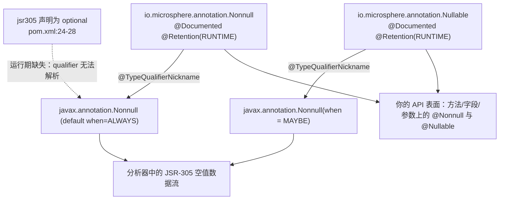

# Microsphere Java Annotations

| | |
|---|---|
| **构件** | `io.github.microsphere-projects:microsphere-java-annotations`（`release` 分支上为 `0.3.20-SNAPSHOT`） |
| **包** | `io.microsphere.annotation`（6 个类型）· `io.microsphere.annotation.concurrent`（2 个类型）—— 共 8 个主源码类型，无其他代码 |
| **内容** | 8 个注解接口 + 6 个 JUnit 5 测试；类、枚举、接口和服务注册**全部为零** |
| **JDK 级别** | 整个 reactor 中不存在任何 `maven.compiler.*` / `<release>` 属性 —— 字节码级别继承自外部父工程 `microsphere-build:0.3.16`（`pom.xml:6-10`）；CI 在 JDK 8 / 11 / 17 / 21 / 25（Temurin）上验证 |
| **编译依赖** | `com.google.code.findbugs:jsr305`，声明为 `optional`（`microsphere-java-annotations/pom.xml:24-28`）—— 除此之外没有任何仓库内或第三方依赖 |
| **Retention 分布** | `SOURCE` ×1（`@Experimental`）· `CLASS` ×2（`@ThreadSafe`、`@NotThreadSafe`）· `RUNTIME` ×5（`@ConfigurationProperty`、`@Immutable`、`@Nonnull`、`@Nullable`、`@Since`） |

本模块是 Microsphere Java 的**契约层（contract layer）**。它发布八个注解，用来声明库对某段代码的承诺——“这个
方法永远不返回 `null`”“这个对象的状态永远不变”“这个 API 从 1.0.0 就存在”“这个字段是一个配置属性”——却不交付
任何强制执行这些承诺的代码。reactor 里的其他代码都可以读取它们；而要使用它们，也不需要 reactor 里的任何其他代码。

**当你想用自己的 API 声明一条不变式**，并且希望措辞和 Microsphere 系列库保持一致时，就引入这个构件
（`@Nonnull` / `@Nullable` / `@Immutable`，在 reactor 中分别被 74–99 个主源码文件导入），或者希望用
`@ConfigurationProperty` 把你的配置键收集进 `META-INF/microsphere/configuration-properties.json`。引入这个 jar
在运行期没有任何代价：其中的类永远不会被加载；真正*读取*这些注解的代码只存在于编译期（注解处理器）或你自己的
测试里。

> [!NOTE]
> **注解永不抛异常。** 全库统一的*静默降级（silent degradation）*策略（返回中性值而不是抛错）在这里有一个精确
> 的对应物：本模块里没有任何注解会失败，因为它们都不携带可执行行为。`@Nonnull` 不会插入
> `NullPointerException`，`@ThreadSafe` 不会添加同步，`@ConfigurationProperty` 也不会绑定任何值。强制执行永远是
> *另一个*工具的职责——静态分析器、注解处理器，或者你自己的反射代码。

---

## 1. 本模块的用途，以及它为什么是独立构件

| 我想… | 使用 | 真正的读取方 |
|---|---|---|
| 承诺某个值永不为 `null` | `io.microsphere.annotation.Nonnull` | 支持 JSR-305 的静态分析器（通过 `@TypeQualifierNickname`，`annotation/Nonnull.java:35`）；人类；你的测试通过反射 |
| 承诺某个值可以为 `null` | `io.microsphere.annotation.Nullable` | 同上，形式为 `@javax.annotation.Nonnull(when = MAYBE)`（`annotation/Nullable.java:36`） |
| 承诺某个对象不可变 | `io.microsphere.annotation.Immutable` | 仅文档与反射检查——它**不**携带任何 JSR-305 关联（`annotation/Immutable.java:31-34`） |
| 承诺某个类（不）线程安全 | `io.microsphere.annotation.concurrent.ThreadSafe` / `NotThreadSafe` | 仅字节码扫描器——`CLASS`（`concurrent/ThreadSafe.java:28`、`concurrent/NotThreadSafe.java:27`） |
| 记录一个 API 何时出现 | `io.microsphere.annotation.Since` | 你自己的反射工具；`RUNTIME` + `TYPE_USE`（`annotation/Since.java:42`、`:53`） |
| 标记某特性可被移除 | `io.microsphere.annotation.Experimental` | 仅编译器与 IDE——`SOURCE`（`annotation/Experimental.java:37`） |
| 发布一个配置键 | `io.microsphere.annotation.ConfigurationProperty` | 编译期的 `microsphere-annotation-processor`，之后是运行期的 `io.microsphere.metadata.*` 读取方 |

这些注解住在独立模块里、而不是待在 `microsphere-java-core` 内部，有四个原因：

1. **它是一个没有仓库内依赖的叶子。** 它的 POM 只声明了一个依赖 `jsr305`，并将其标记为 optional
   （`microsphere-java-annotations/pom.xml:21-43`）。因此把它放到*任何* classpath 上都是安全的，包括那些不允许
   看到运行期库的 classpath。
2. **`core` 只单向消费它。** `microsphere-java-core` 在 **compile（非 optional）** 作用域依赖本模块
   （`microsphere-java-core/pom.xml:24-28`）；注解模块不依赖 reactor 中的任何东西。正是这条单向边，让 reactor
   中 138 个主源码文件（267 处 import）能够携带这些契约而不产生依赖环。
3. **编译期工具可以在不加载库的前提下加载它。** `microsphere-annotation-processor` 经由 core 触达注解类型
   （`microsphere-annotation-processor/pom.xml:24-28`），并且是*按名字*匹配的——
   `"io.microsphere.annotation.ConfigurationProperty"`
   （`.../processor/ConfigurationPropertyJSONElementVisitor.java:59`）——所以一个项目只要注解类在场就能跑处理器。
4. **测试支撑模块可以选择退出。** `microsphere-java-test` 把该依赖声明为 optional
   （`microsphere-java-test/pom.xml:24-28`），消费者因此自选版本，而不是被强制继承一个版本。

---

## 2. 坐标

```xml
<dependency>
    <groupId>io.github.microsphere-projects</groupId>
    <artifactId>microsphere-java-annotations</artifactId>
    <version>0.3.20</version> <!-- 最新已发布 tag；0.3.20-SNAPSHOT 是这条线的开发版本 -->
</dependency>
```

| 字段 | 值 | 证据 |
|---|---|---|
| Group ID | `io.github.microsphere-projects` | `pom.xml:12` |
| Artifact ID | `microsphere-java-annotations` | `microsphere-java-annotations/pom.xml:14` |
| 版本 | `release` 上 `${revision}` = `0.3.20-SNAPSHOT` | `pom.xml:54`、`microsphere-java-annotations/pom.xml:15` |
| reactor 中的位置 | 第 3 个构建的模块 | `pom.xml:60`（modules 见 `:57-67`） |
| 打包方式 | `jar` | `microsphere-java-annotations/pom.xml:16` |
| 父工程 | `microsphere-java-parent:${revision}` | `microsphere-java-annotations/pom.xml:5-10` |
| 构建父工程（祖父） | `microsphere-build:0.3.16` | `pom.xml:6-10` |
| 唯一的编译依赖 | `com.google.code.findbugs:jsr305`，`optional`，**没有 `<version>`** | `microsphere-java-annotations/pom.xml:24-28` |
| 该版本从哪里来 | 导入的 BOM `microsphere-all-bom:0.3.13` | `microsphere-java-parent/pom.xml:22`、`:31-37` |
| 测试依赖 | `org.junit.jupiter:junit-jupiter` + `junit-jupiter-engine`，`test` 作用域 | `microsphere-java-annotations/pom.xml:30-41` |
| 可消费的 BOM | `microsphere-java-dependencies` 管理本构件 | `microsphere-java-dependencies/pom.xml:24-28` |

> [!IMPORTANT]
> 与 `microsphere-java-core` 的关系和“不被依赖”恰好相反。在 `release` 上，**core 确实在 compile 作用域依赖本模块，
> 而且该依赖不是 optional**（`microsphere-java-core/pom.xml:24-28`），因此 `microsphere-java-core` 的每个消费者都会
> 传递性地拿到这八个注解。真正 optional 的是本模块内部的 `jsr305`
> （`microsphere-java-annotations/pom.xml:27`）——而 core 只在 **test** 作用域声明 `jsr305`
> （`microsphere-java-core/pom.xml:73-78`）。后果是：core 编译和运行时 `io.microsphere.annotation.*` 在场、
> `javax.annotation.*` 不在场，而这完全合法，因为*使用*一个注解从来不需要它的元注解也在 classpath 上。

---

## 3. 版本信息与兼容性

| 事实 | 值 | 证据 |
|---|---|---|
| 发布线 | `release` 分支 | — |
| 开发版本 | `0.3.20-SNAPSHOT` | `pom.xml:54` |
| 最新已发布 tag | `0.3.20` | release notes / Maven Central |
| javadoc 声明的 `@since` | `io.microsphere.annotation` 下六个类型全部为 `1.0.0` | `annotation/ConfigurationProperty.java:33`、`annotation/Experimental.java:34`、`annotation/Immutable.java:29`、`annotation/Nonnull.java:30`、`annotation/Nullable.java:32`、`annotation/Since.java:40` |
| `concurrent` 的 `@since` | **没有** —— 这对 JCIP 来源的注解不带 `@author`/`@since` javadoc | `annotation/concurrent/ThreadSafe.java:17-25`、`annotation/concurrent/NotThreadSafe.java:17-24` |
| JDK 兼容性 | 8、11、17、21、25（Temurin） | `.github/workflows/maven-build.yml:25`、`:33` |
| Spring Framework 范围 | JDK `[1.8,17)` 上经 profile `java8-16` 使用 5.3.39；其余为 7.0.9 | `microsphere-java-parent/pom.xml:23`、`:54-62`（激活条件 `:57`） |
| 字节码级别 | 本仓库中未设置 —— 继承自 `microsphere-build:0.3.16` | reactor 中不存在任何 `maven.compiler.*` / `<release>` 属性 |

由于本模块只有注解，其兼容性稳定得异乎寻常：

| 关注点 | JDK 8 | JDK 9 / 11 / 17 / 21 / 25 | 证据 |
|---|---|---|---|
| 加载注解类 | 可用 | 可用 | 8 个文件里完全没有引用任何 JDK 内部 API |
| `@Since` 用于 `TYPE_PARAMETER` / `TYPE_USE` | 支持（两者都由 Java 8 引入） | 支持 | `annotation/Since.java:52-53` |
| `@Nonnull` / `@Nullable` 用于 `List<@Nonnull String>` | **编译错误** —— 没有 `TYPE_USE` 目标 | 同样 | `annotation/Nonnull.java:32-36`、`annotation/Nullable.java:34-38` 上没有 `@Target` |
| 通过反射读取 `@Experimental` | 永远是 `null` | 永远是 `null` | `annotation/Experimental.java:37`，由 `src/test/java/io/microsphere/annotation/ExperimentalTest.java:35` 证实 |
| 通过反射读取 `@ThreadSafe` | `null`（`CLASS` retention） | `null` | `annotation/concurrent/ThreadSafe.java:28` |
| `javax.annotation.meta.*` 的解析 | 需要 classpath 上有 `jsr305` | 同样 | `annotation/Nonnull.java:19`、`annotation/Nullable.java:19`、`:24` |

> [!TIP]
> 既然模块里没有任何东西会跨 JDK 出问题，请把**保留策略（retention policy）**而不是 JDK 版本当作兼容性面。
> 真正改变某个工具能观察到什么的唯一决定，就是 `SOURCE` / `CLASS` / `RUNTIME`，而这八个选择全部钉在下面的
> §4–§8 中。


### 3.1 `0.3.20` 的发布日期与变更摘要

| 条目 | 值 | 依据 |
|---|---|---|
| 文档所在线 | `release` 分支，`${revision}` = `0.3.20-SNAPSHOT` | 根 `pom.xml:54` |
| 最新已发布版本 | `0.3.20`，标签日期 **2026-10-16** | 标签 `0.3.20` 的提交信息为 `chore: merge main into release [skip ci]`，提交时间 `2026-10-16T03:43:20Z` |
| 上一版本 | `0.3.19`，标签日期 **2026-08-30** | 标签 `0.3.19`，提交时间 `2026-08-30T12:51:37Z` |
| 变更日志来源 | 仓库根目录的 `release-notes.md` | 本项目不发布 `CHANGELOG.md`；`release-notes.md` 的 `v0.3.16`–`v0.3.20` 段落写着 *Release notes generation failed* 并保留原始提交列表，因此下文一律以提交主题引用，并逐条与 `release` 源码核对。 |

`0.3.20` 在这一区域没有新增 API 面——`0.3.19...0.3.20` 区间是一次加固性发布。它实际改变了什么、以及这些改动触及本页源码的程度如下：

* **空值契约。** 本页覆盖范围内 0 / 8 个主源码在签名上声明了 `@Nonnull` / `@Nullable`。
* **该区间没有其它改动触及本页覆盖的区域。**

> [!NOTE]
> 如何读这份提交清单：该区间没有点名本模块的提交，八个源码也都不含 `@Nonnull` / `@Nullable`——这是设计使然：本模块*定义*的正是 `0.3.20` 契约改造所施加的那些注解类型。

---

## 4. 可空性：`@Nonnull` 与 `@Nullable`

这两个是整个 reactor 中使用最广的类型：`import io.microsphere.annotation.Nonnull` 出现在 **99** 个主源码文件中，
`…Nullable` 出现在 **76** 个中，覆盖 `microsphere-java-core` 的每一个公开 API 表面。

### `@Nonnull` —— annotation/Nonnull.java

```java
@Documented                       // :32
@Retention(RUNTIME)               // :33
@javax.annotation.Nonnull         // :34  ← 它所别名的 JSR-305 qualifier
@TypeQualifierNickname            // :35  ← JSR-305：“我是上面那个 qualifier 的昵称”
public @interface Nonnull {       // :36  ← 注意第二个 n 是小写
}
```

| 属性 | 值 | 证据 |
|---|---|---|
| `@Target` | **缺失** → 适用于所有*声明*上下文（type、field、method、parameter、constructor、local variable、package、annotation type）；**不**适用于 type-use 位置 | `annotation/Nonnull.java:32-36` |
| `@Retention` | `RUNTIME` | `annotation/Nonnull.java:33` |
| `@Documented` | 是 | `annotation/Nonnull.java:32` |
| 属性 | 无 —— 纯粹标记（marker） | `annotation/Nonnull.java:36-37` |
| JSR-305 关联 | `@javax.annotation.Nonnull`（默认 `when = ALWAYS`）+ `@javax.annotation.meta.TypeQualifierNickname` | `annotation/Nonnull.java:19`、`:34-35` |
| 许可证头 | Spring 风格的 `Copyright 2002-2019`（包内其他四个类型用的是 ASF 头） | `annotation/Nonnull.java:1-15` |

### `@Nullable` —— annotation/Nullable.java

```java
@Documented                                 // :34
@Retention(RUNTIME)                         // :35
@javax.annotation.Nonnull(when = MAYBE)     // :36  ← “并非确定非空” == 可空
@TypeQualifierNickname                      // :37
public @interface Nullable {                // :38
}
```

| 属性 | 值 | 证据 |
|---|---|---|
| `@Target` | 缺失 —— 作用范围与 `@Nonnull` 相同 | `annotation/Nullable.java:34-38` |
| `@Retention` | `RUNTIME` | `annotation/Nullable.java:35` |
| `@Documented` | 是 | `annotation/Nullable.java:34` |
| 属性 | 无 | `annotation/Nullable.java:38-39` |
| JSR-305 关联 | `@javax.annotation.Nonnull(when = javax.annotation.meta.When.MAYBE)` + `@TypeQualifierNickname` | `annotation/Nullable.java:19`、`:24`、`:36-37` |

### JSR-305 别名机制如何工作（以及它给你什么）

`@TypeQualifierNickname` 是 JSR-305 的机制，含义是*“请把携带我的那个注解，看作是我自己身上那个 type qualifier
的同义词”*。因此一个合规的分析器在读到

```java
@Nonnull public static Version ofVersion(@Nonnull String version);
```

时，会把 `io.microsphere.annotation.Nonnull` 解析为 `javax.annotation.Nonnull`，并套用 JSR-305 的空值数据流规则；
而你的源码保留的是一个中立的名字，永远不会与 `javax.annotation.Nonnull`、`org.springframework.lang.NonNull`
或 JetBrains 的等价物冲突。`@Nullable` 用的是同一个别名，只不过把 qualifier *参数化*（`when = MAYBE`）而非替换——
这是 JSR-305 表达“并非确定非空”的惯用法；选择它而不是 `javax.annotation.Nullable`，是为了让两个注解都经由同一个
qualifier 类型解析。



> [!WARNING]
> 这个设计**不**提供两样东西。（1）没有包级别默认可空性：`@TypeQualifierDefault` 在整个 reactor 中一处都没有出现，
> 本模块也不提供 `package-info.java`，所以“未标注即非空”并*没有*被编码进去——请逐个标注你在意的元素。
> （2）别名只对既理解 JSR-305、又把 `jsr305` 放在 classpath 上的工具有效；而 `jsr305` 在本模块是 `optional`
> （`microsphere-java-annotations/pom.xml:27`），在 core 中是 `test` 作用域
> （`microsphere-java-core/pom.xml:73-78`），所以一个只带 `core` 的普通运行环境既没有 qualifier 也没有数据流引擎。

### 可以直接照抄的真实用法

| 场景 | 片段 | 证据 |
|---|---|---|
| 可空返回值（写出来而不是暗示） | `@Nullable public static ClassLoader getDefaultClassLoader()` | `microsphere-java-core/src/main/java/io/microsphere/util/ClassLoaderUtils.java:243-244` |
| 同时用于返回集合的方法 | `@Nonnull @Immutable public static Set<URL> getResources(@Nullable ClassLoader classLoader, @Nonnull ResourceType resourceType, String resourceName)` | `.../util/ClassLoaderUtils.java:667-669` |
| 可空字段 | `@Nullable private final String preRelease;` | `.../util/Version.java:101-102` |
| 非空方法 | `@Nonnull public static Version getVersion(Class<?> targetClass)` | `.../util/Version.java:649-650` |
| 参数标注 | `protected ClassPathResourceConfigurationPropertyLoader(@Nonnull String resourceName, @Nullable ClassLoader classLoader)` | `.../metadata/ClassPathResourceConfigurationPropertyLoader.java:63` |

---

## 5. 不可变性：`@Immutable`

```java
@Documented            // annotation/Immutable.java:31
@Retention(RUNTIME)    // annotation/Immutable.java:32
public @interface Immutable {   // :33  — 空体：没有属性
}
```

| 属性 | 值 | 证据 |
|---|---|---|
| 含义 | “调用方看不到其状态发生变化” | `annotation/Immutable.java:24-25` |
| `@Target` | 缺失 → 所有声明上下文，不含 type-use | `annotation/Immutable.java:31-34` |
| `@Retention` | `RUNTIME` | `annotation/Immutable.java:32` |
| `@Documented` | 是 | `annotation/Immutable.java:31` |
| JSR-305 关联 | **无** —— 它*不*别名 `javax.annotation.concurrent.Immutable` | `annotation/Immutable.java:17-34` 中的缺失（对比 `annotation/Nonnull.java:34-35`） |

最后一行最让人意外：`@Immutable` 位于 `io.microsphere.annotation`，而不是 `concurrent` 子包，而且它是一个*纯粹的
Microsphere 标记注解*。FindBugs/SpotBugs 这类分析器在寻找 `javax.annotation.concurrent.Immutable` 时，不会把
`@Immutable` 标注的类视为深度不可变。它实际扮演的角色，是返回集合时 `@Nonnull` 那个可读、可反射可见的伙伴：

| 场景 | 片段 | 证据 |
|---|---|---|
| 类级别 | `@Immutable public class Version implements Comparable<Version>, Serializable` | `.../util/Version.java:90-91` |
| 方法级别，与 `@Nonnull` 搭配 | `@Nonnull @Immutable public static Set<ClassLoader> getInheritableClassLoaders(…)` | `.../util/ClassLoaderUtils.java:1067-1069` |
| SPI 静态方法上 | `@Nonnull @Immutable static List<ConfigurationProperty> loadAll()` | `.../metadata/ConfigurationPropertyLoader.java:89-91` |
| 字段上（快照） | `@Immutable private static final Set<String> bootstrapClassPaths = initBootstrapClassPaths();` | `.../util/ClassPathUtils.java:60-61`，`classPaths` 见 `:63-64` |

---

## 6. 线程安全：`@ThreadSafe` 与 `@NotThreadSafe`

```java
// annotation/concurrent/ThreadSafe.java
@Documented          // :26
@Target(TYPE)        // :27
@Retention(CLASS)    // :28
public @interface ThreadSafe {}   // :29

// annotation/concurrent/NotThreadSafe.java
@Documented          // :25
@Target(TYPE)        // :26
@Retention(CLASS)    // :27
public @interface NotThreadSafe {}   // :28
```

| 属性 | `@ThreadSafe` | `@NotThreadSafe` |
|---|---|---|
| 可作用于 | 仅类 / 接口 / 枚举 / 注解类型（`TYPE`） | 同 |
| Retention | `CLASS` —— 在 `.class` 文件里，但 `Class.getAnnotation(...)` **看**不到 | `CLASS` |
| `@Documented` | 是（`:26`） | 是（`:25`） |
| 属性 | 无 | 无 |
| 语义来源 | Brian Goetz / JCIP，在文件头注明（`:1-6`） | 同 |
| 交叉引用 | `@see NotThreadSafe`（`:24`） | `@see ThreadSafe`（`:23`） |
| 在 `release` 中被使用？ | **没有** | **没有** |

语义就是 JCIP 的那套，javadoc 里逐字引用：`@ThreadSafe` 表示“任何访问序列……都不会把对象置于非法状态，无论
线程如何交错……也不需要任何额外的同步”（`annotation/concurrent/ThreadSafe.java:18-22`）；`@NotThreadSafe` 的存在
是为了警告那些“本来可能被误认为线程安全”的类
（`annotation/concurrent/NotThreadSafe.java:18-21`）。

> [!WARNING]
> **这两个注解在本仓库中没有任何类型上使用。** 搜索整个 `release` worktree，`io.microsphere.annotation.concurrent`
> 只出现在声明它自己的那两个文件里——core 的线程安全工具（`ClassLoaderUtils`、`ServiceLoaderUtils`）是通过
> `static final` 不可变字段和 `ConcurrentHashMap` 来表达安全性的
> （例如 `.../util/ClassLoaderUtils.java:92`、`.../util/ServiceLoaderUtils.java:140`）。如果你想让*库*被记录为线程
> 安全，请标注你自己的类型；不要去 grep 仓库内的例子，因为不存在。
>
> 这两个文件还各自带有一个**未使用且名字交叉的 import**：`ThreadSafe.java:9` 导入
> `javax.annotation.concurrent.NotThreadSafe`，`NotThreadSafe.java:9` 导入
> `javax.annotation.concurrent.ThreadSafe`。两个 import 都没有被作为元注解使用，因此与 `@Nonnull`/`@Nullable`
> 不同，这一对**完全没有 JSR-305 别名**——它们只是残留。

由于 `CLASS` retention 会在你的程序运行之前抹掉注解，诚实的用法只有两种：(a) 编译期与字节码分析，(b) 人类读者。
如果你需要一个可运行期检查的声明，请改用 `@Immutable`（见 §5），它是 `RUNTIME`。

---

## 7. 生命周期与版本：`@Since` 与 `@Experimental`

### `@Since` —— annotation/Since.java

```java
@Retention(RUNTIME)      // :42
@Target({                // :43-54
    TYPE, FIELD, METHOD, PARAMETER, CONSTRUCTOR, LOCAL_VARIABLE,
    ANNOTATION_TYPE, PACKAGE, TYPE_PARAMETER, TYPE_USE
})
@Documented              // :55
public @interface Since {
    String module() default "";   // :61
    String value();               // :66  ← 必填，无默认值
}
```

| 属性 | 值 | 证据 |
|---|---|---|
| Retention | `RUNTIME` | `annotation/Since.java:42` |
| Target | **全部十个** element type —— 八个注解中最宽的 | `annotation/Since.java:43-54` |
| `@Documented` | 是，声明在最后（`:55`） | `annotation/Since.java:55` |
| 必填属性 | `value()` —— 版本号，例如 `"1.0.0"` | `annotation/Since.java:66` |
| 可选属性 | `module()` —— 例如 `"microsphere-java-core"` | `annotation/Since.java:61` |
| JSR-305 关联 | 无 | `annotation/Since.java:19-33` |

```java
@Since(module = "microsphere-java-core", value = "1.0.0")   // src/test/java/io/microsphere/annotation/SinceTest.java:30
```

其他真实用法：core 中一个测试夹具类上的
`@Since(module = "microsphere-java-core", value = "1.0.0")`
（`microsphere-java-core/src/test/java/io/microsphere/util/AnnotationUtilsTest.java:710`），作为另一个注解的
注解类型属性声明的 `Since since();`
（`microsphere-java-test/src/main/java/io/microsphere/test/annotation/TestAnnotation.java:69`），以及作为该属性值
提供的 `@Since("1.0.0")`（`.../test/service/TestServiceImpl.java:70`）。

### `@Experimental` —— annotation/Experimental.java

```java
@Documented        // :36
@Retention(SOURCE) // :37
@Target({ANNOTATION_TYPE, CONSTRUCTOR, FIELD, METHOD, TYPE})   // :38-44
public @interface Experimental {
    String description() default "";   // :50
}
```

| 属性 | 值 | 证据 |
|---|---|---|
| Retention | `SOURCE` —— 永远进不了 `.class` 文件 | `annotation/Experimental.java:37` |
| Target | 5 个上下文：`ANNOTATION_TYPE`、`CONSTRUCTOR`、`FIELD`、`METHOD`、`TYPE` | `annotation/Experimental.java:38-44` |
| 不可用于 | `PACKAGE`、`PARAMETER`、`LOCAL_VARIABLE`、`TYPE_PARAMETER`、`TYPE_USE` | 同一个代码块 |
| 属性 | `description()`（默认 `""`） | `annotation/Experimental.java:50` |
| javadoc 意图 | “将来可能改变甚至被移除” | `annotation/Experimental.java:31` |
| 在 `release` 中使用？ | 恰好一次 —— 在它自己的测试里 | `src/test/java/io/microsphere/annotation/ExperimentalTest.java:30` |

> [!NOTE]
> `ExperimentalTest` 是整个模块里对保留策略语义最清晰的表述：它给自己的类加上
> `@Experimental(description = "ExperimentalTest")`（`:30`），然后断言该注解在运行期**不存在**——
> `assertNull(ExperimentalTest.class.getAnnotation(Experimental.class))`（`:35`）。那些 `RUNTIME` 类型对应的测试
> 断言的正好相反（`NonnullTest.java:36`、`NullableTest.java:36`、`ImmutableTest.java:36`）并且通过。

`@Since` 与 `@Experimental` 被文档化为搭档（`annotation/Since.java:39` 处的 `@see Experimental`）：`@Since` 回答
“这是什么时候出现的”，`@Experimental` 回答“它有多稳定”。注意 `@Since` 在 reactor 中只出现在**两个**主源码文件里，
而 *javadoc* 的 `@since 1.0.0` 标签则无处不在——在这个库里，注解是对 javadoc 标签的补充，而不是替代。

---

## 8. 配置元数据：`@ConfigurationProperty`

```java
@Documented          // annotation/ConfigurationProperty.java:35
@Retention(RUNTIME)  // :36
@Target(FIELD)       // :37
public @interface ConfigurationProperty { … }   // :38
```

| 属性 | 类型 | 默认值 | 含义 | 证据 |
|---|---|---|---|---|
| `name()` | `String` | `""` | 配置键；为空则由字段的编译期常量值推断 | `annotation/ConfigurationProperty.java:60` |
| `type()` | `Class<?>` | `String.class` | 声明的属性类型 | `:67`（其 javadoc 标签拼写为 `@reurn`，`:65`） |
| `defaultValue()` | `String` | `""` | 属性未设置时使用的值 | `:74` |
| `required()` | `boolean` | `false` | 是否必须存在 | `:81` |
| `description()` | `String` | `""` | 人类可读文档；为空则取字段的 javadoc | `:88` |
| `source()` | `String[]` | `{}` | 值可能来自哪里 | `:95` |

| 常量 | 值 | 证据 |
|---|---|---|
| `SYSTEM_PROPERTIES_SOURCE` | `"system-properties"` | `annotation/ConfigurationProperty.java:43` |
| `ENVIRONMENT_VARIABLES_SOURCE` | `"environment-variables"` | `:48` |
| `APPLICATION_SOURCE` | `"application"` | `:53` |

钉住这三个常量的测试：`src/test/java/io/microsphere/annotation/ConfigurationPropertyTest.java:38-40`。

core 中被标注的字段（这是预期用法——保存属性名的 `public static final` 常量）：

```java
// microsphere-java-core/src/main/java/io/microsphere/security/SecurityUtils.java:44-45
@ConfigurationProperty(source = SYSTEM_PROPERTIES_SOURCE)
public static final String JAVA_SECURITY_POLICY_FILE_PROPERTY_NAME = "java.security.policy";

// .../util/ServiceLoaderUtils.java:132-138
@ConfigurationProperty(
        name = SERVICE_LOADER_CACHED_PROPERTY_NAME,
        defaultValue = DEFAULT_SERVICE_LOADER_CACHED_PROPERTY_VALUE,
        description = "Whether to cache the loaded services",
        source = SYSTEM_PROPERTIES_SOURCE
)
public static final boolean SERVICE_LOADER_CACHED = parseBoolean(getProperty(...));

// .../beans/BeanUtils.java:118-124 — name + defaultValue + 拼接而成的 description
```

其他被标注的字段：`.../util/ShutdownHookUtils.java:101`、`.../io/IOUtils.java:85`、
`.../io/StandardFileWatchService.java:125`、`.../process/ProcessExecutor.java:78`、
`.../reflect/MethodUtils.java:121`、`.../classloading/ManifestArtifactResourceResolver.java:128` 和 `:147`。
非常量（实例）字段在测试支撑模型里同样被标注：
`microsphere-java-test/src/main/java/io/microsphere/test/model/ConfigurationPropertyModel.java:31-44`。

这个注解**同时**可在编译期和运行期被读取：

* 编译期 —— `ConfigurationPropertyAnnotationProcessor`（`@SupportedAnnotationTypes` 位于
  `microsphere-annotation-processor/src/main/java/io/microsphere/annotation/processor/ConfigurationPropertyAnnotationProcessor.java:77`，
  通过 `src/main/resources/META-INF/services/javax.annotation.processing.Processor:1` 注册）逐字段访问，复制六个
  属性，写出 `META-INF/microsphere/configuration-properties.json`
  （`.../ConfigurationPropertyAnnotationProcessor.java:98-105`、`:150`；资源名见
  `microsphere-java-core/src/main/java/io/microsphere/constants/ResourceConstants.java:54`，文件名见 `:43`）。
* 运行期 —— 测试代码中存在反射读取方：
  `field.isAnnotationPresent(ConfigurationProperty.class)` /
  `field.getAnnotation(ConfigurationProperty.class)` 位于
  `microsphere-java-test/src/test/java/io/microsphere/test/model/ConfigurationPropertyModelTest.java:84-85`。
  随包发布的 JSON 产物可读于
  `microsphere-java-core/src/main/resources/META-INF/microsphere/configuration-properties.json:1-15`。

> [!IMPORTANT]
> 若编译 classpath 上没有注解处理器，`@ConfigurationProperty` 就只是**惰性的文档**：字段带着它，没有任何东西消费它，
> 也不会产出 `configuration-properties.json`。配套页面是
> [microsphere-annotation-processor](./module-microsphere-annotation-processor.zh.md)——它覆盖处理轮次、`Filer`/`Messager`
> 用法以及被 shade 进产物的细节。

---

## 9. 可运行示例（取自真实测试与源码）

```java
// 1. Retention 决定可见性 — src/test/java/io/microsphere/annotation/ExperimentalTest.java:30-35
@Experimental(description = "ExperimentalTest")   // SOURCE
class Demo { }
assertNull(Demo.class.getAnnotation(Experimental.class));      // 类文件生成之前就被擦除

// 2. RUNTIME 注解可被读取 — src/test/java/io/microsphere/annotation/NonnullTest.java:31-36
@Nonnull class Doc { }
assertNotNull(Doc.class.getAnnotation(Nonnull.class));

// 3. 属性能活过反射 — src/test/java/io/microsphere/annotation/SinceTest.java:30-37
@Since(module = "microsphere-java-core", value = "1.0.0")
class SinceDemo { }
Since since = SinceDemo.class.getAnnotation(Since.class);
assertEquals("1.0.0", since.value());

// 4. 那三个常量就是 source() 的词汇表 —
//    src/test/java/io/microsphere/annotation/ConfigurationPropertyTest.java:38-40
assertEquals("system-properties", ConfigurationProperty.SYSTEM_PROPERTIES_SOURCE);
assertEquals("environment-variables", ConfigurationProperty.ENVIRONMENT_VARIABLES_SOURCE);
assertEquals("application", ConfigurationProperty.APPLICATION_SOURCE);

// 5. 惯用声明位置 — microsphere-java-core/.../beans/BeanUtils.java:118-124
@ConfigurationProperty(
        name = BEAN_PROPERTIES_MAX_RESOLVED_DEPTH_PROPERTY_NAME,
        defaultValue = DEFAULT_BEAN_PROPERTIES_MAX_RESOLVED_DEPTH_PROPERTY_VALUE,
        description = "The maximum depth of resolving properties of a bean …"
)
public static final int BEAN_PROPERTIES_MAX_RESOLVED_DEPTH = getInteger(...);
```

---

## 10. 常见陷阱

1. **`RUNTIME` / `CLASS` / `SOURCE` 在这里就是全部 API 契约。** `@Experimental` 是 `SOURCE`
   （`annotation/Experimental.java:37`），因此编译之后*没有任何东西*能看到它——反射看不到，SpotBugs 看不到，
   另一个模块里 IDE 的检查缓存也看不到。`@ThreadSafe` / `@NotThreadSafe` 是 `CLASS`
   （`annotation/concurrent/ThreadSafe.java:28`、`annotation/concurrent/NotThreadSafe.java:27`），因此它们存在于
   字节码中，但 `getAnnotation()` 永远返回 `null`。只有那五个 `RUNTIME` 类型在运行中的 JVM 里可读。
2. **type-use 位置只有 `@Since` 能编译。** `List<@Nonnull String>` 是编译错误，因为 `@Nonnull` 没有声明 `@Target`，
   因而不含 `ElementType.TYPE_USE`（`annotation/Nonnull.java:32-36`），而 `@Since` 显式列出了 `TYPE_USE`
   （`annotation/Since.java:53`）。请把 `@Nonnull` 放在*方法*上，而不是放进返回类型里。
3. **标注包：有的可以，有的不行。** `@Since` 声明了 `PACKAGE`（`annotation/Since.java:51`），
   `@Nonnull` / `@Nullable` / `@Immutable` 隐式允许（因为没有 `@Target`）；而 `@Experimental`（`:38-44`）、
   `@ConfigurationProperty`（`@Target(FIELD)`，`:37`）和 `concurrent` 那一对（`@Target(TYPE)`）都无法放在
   `package-info.java` 上。
4. **不存在默认可空性作用域。** reactor 中任何地方都没有 `@TypeQualifierDefault`，本模块也没有 `package-info.java`，
   所以未标注的元素就是未标注——不要按某些 JSR-305 项目的配置去假设“默认非空”语义。
5. **`@Immutable` 不是 JSR-305 的 `Immutable`。** 它不携带任何元注解（`annotation/Immutable.java:31-34`），
   所以基于 JSR-305 的工具不会把该类当作深度不可变，它本身也不蕴含线程安全。JCIP 的线程安全语言住在 `concurrent`
   包——而那恰恰是同样没有别名 JSR-305 的包（§6）。
6. **省略 `name()` 要求字段是编译期常量。** 处理器从 `field.getConstantValue()` 推断名字
   （`.../processor/ConfigurationPropertyJSONElementVisitor.java:119-122`），对非 `static final` 或非字面量的字段
   该值为 `null`；随后的模型构造函数会抛出 `IllegalArgumentException`
   （`.../beans/ConfigurationProperty.java:120`，由
   `microsphere-java-core/src/test/java/io/microsphere/beans/ConfigurationPropertyTest.java:62` 断言）。实例字段上
   请始终显式传 `name = …`。
7. **`@ConfigurationProperty` 要有处理器才有用。** 它的文档化目的就是生成元数据
   （`annotation/ConfigurationProperty.java:30`）；如果不把 `microsphere-annotation-processor` 配置为编译器的注解
   处理器，JSON 资源永远不会出现，`AdditionalMetadataResourceConfigurationPropertyLoader` 这类运行期读取方也就无物
   可载。参见 [microsphere-annotation-processor](./module-microsphere-annotation-processor.zh.md)。
8. **`jsr305` 是 optional，因此 JSR-305 别名可能无法解析。** `@Nonnull`/`@Nullable` 上的
   `@TypeQualifierNickname` 和 `javax.annotation.Nonnull`
   （`annotation/Nonnull.java:19`、`:34-35`；`annotation/Nullable.java:19`、`:24`、`:36-37`）来自一个被标记为
   `optional` 的依赖（`microsphere-java-annotations/pom.xml:24-28`）。想要空值数据流分析，请自己添加 `jsr305`
   （或等价的 qualifier 提供方）。
9. **没有任何注解在运行期强制执行。** 参数上的 `@Nonnull` 在你传 `null` 时不会抛异常，`@ThreadSafe` 也不会同步。
   与库的静默降级策略一致，强制执行点永远在别处——在 core 里，*受检*的变体是显式的
   （`Assert.assertNotNull`，用于 `.../beans/ConfigurationProperty.java:120`），所以当下游真的依赖这条保证时，请把
   `@Nonnull` 和一个断言配起来。
10. **拼写，以及唯一的必填属性。** 类型名是 `Nonnull`（第二个字母小写），与 `javax.annotation.Nonnull` 对齐
    （`annotation/Nonnull.java:36`），而不是 Spring 的 `NonNull`；同时需要两者的文件必须把其中一个写全限定名——
    core 的 metadata 类型导入的是 Microsphere 的 `@Nonnull`，让 JSR-305 的名字保持未导入
    （`.../metadata/ConfigurationPropertyLoader.java:21`）。另外 `@Since(value = …)` 没有默认值
    （`annotation/Since.java:66`）：`@Since("1.0.0")` 可以编译，光秃秃的 `@Since` 不行；`module()`（`:61`）才是可选部分。

---

## 11. 延伸阅读

* [配置属性元数据 —— `microsphere-java-core`](./microsphere-java-core/configuration-metadata.zh.md) —— 消费 `@ConfigurationProperty` 产物的读取方与生成方
* [语言抽象 —— `microsphere-java-core`](./microsphere-java-core/language-abstractions.zh.md) —— `io.microsphere.lang.Deprecation`，生命周期声明的运行期模型（它读取自己那份 `getSince()` `Version`，`.../lang/Deprecation.java:111`，而不是 `@Since`）
* [microsphere-annotation-processor](./module-microsphere-annotation-processor.zh.md) —— `@ConfigurationProperty` 的编译期消费方
* [Microsphere Java Annotations —— 开发者指南](../developer-guide/module-microsphere-java-annotations.zh.md) —— 保留策略的取舍、消费方地图与设计模式
* 英文版：[English User Guide](./module-microsphere-java-annotations.md)
* [模块索引](./README.zh.md)
