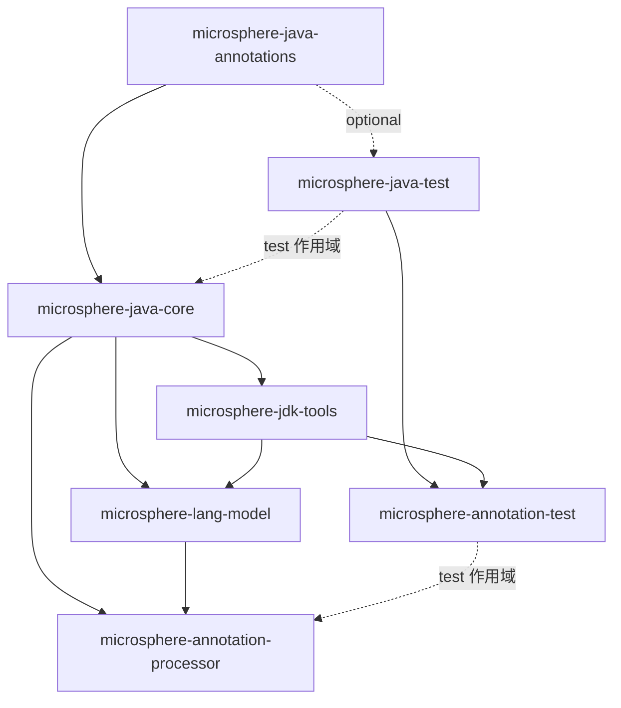

# Microsphere Java 用户文档 —— `release` 分支（`current`）

读者对象：希望在应用或类库中**使用** `microsphere-java` 的开发者 —— 选择合适的构件、调用正确的 API，
并明确可以依赖的 JDK 与库版本。

本目录所有内容均取自 **`release` 分支**（`revision = 0.3.20-SNAPSHOT`；该版本线已发布为 `0.3.20`，即仓库中最新的
标签）。每个页面的中文版位于同名英文文件所在目录的 `zh/` 子目录中。

* 文档总目录与版本线（英文）：[../../../README.md](../../../README.md)
* 开发者文档（架构、源码分析、设计模式）：[../../developer-guide/zh/README.md](../../developer-guide/zh/README.md)

---

## 1. 坐标、版本与兼容性总览

| 项目 | 取值 |
|------|------|
| Group ID（所有构件） | `io.github.microsphere-projects` |
| 本文档对应版本 | `0.3.20-SNAPSHOT`（源码分支 `release`）；已发布为 `0.3.20`，即最新标签 |
| 构建父 POM | `microsphere-build` `0.3.16` → `microsphere-java-parent` → 各模块 |
| 仓库内 BOM | `microsphere-java-dependencies`（统一管理七个模块的版本） |
| 包根 | `io.microsphere.*` |
| 语言级别 | 目标字节码为 **Java 8**（级别继承自外部 `microsphere-build` 父 POM） |
| CI 测试 JDK | Temurin 8、11、17、21、25（`.github/workflows/maven-build.yml`） |
| `core` 的运行时依赖 | **无必需依赖** —— `jsr305`、`javax.annotation-api`、`slf4j-api`、`commons-logging` 均为 optional |
| 许可证 | Apache License 2.0 |

导入 BOM 后即可省略版本号：

```xml
<dependencyManagement>
    <dependencies>
        <dependency>
            <groupId>io.github.microsphere-projects</groupId>
            <artifactId>microsphere-java-dependencies</artifactId>
            <version>0.3.20</version>
            <type>pom</type>
            <scope>import</scope>
        </dependency>
    </dependencies>
</dependencyManagement>

<dependencies>
    <dependency>
        <groupId>io.github.microsphere-projects</groupId>
        <artifactId>microsphere-java-core</artifactId>
    </dependency>
</dependencies>
```

> [!TIP]
> `microsphere-java-dependencies` 由本 reactor 构建，是最小的依赖管理入口。若你所需的版本线在镜像仓库中找不到该 BOM，
> 可改为对每个构件显式声明 `<version>0.3.20</version>` —— 七个模块共用同一个版本（`${revision}`）。

> [!IMPORTANT]
> **兼容性在库内并不是均匀的。** 纯工具类包（`util`、`collection`、`convert`、`reflect`、`event`、`json`）在
> JDK 8 到 25 上行为一致。而涉及 JDK 内部实现的包 —— `classloading`、`io.scanner`、`net`、`process`、`management`，
> 以及整条注解处理工具链（`microsphere-jdk-tools`、`microsphere-lang-model`、`microsphere-annotation-processor`）
> 存在按 JDK 差异的行为，对应页面都给出了显式的 JDK 矩阵以及所需的 `--add-exports` / `--add-opens` 参数。

---

## 2. 模块依赖关系



按使用视角自下而上阅读：运行期依赖 `core`；编译期依赖 `microsphere-annotation-processor`；
`*-test` 模块只在 `src/test` 中使用。

---

## 3. 页面清单

### 3.1 `microsphere-java-core` —— 按包分组共 14 篇

| 页面 | 覆盖的包（main 源码） | 类型数 | 适用场景 |
|------|------------------------|--------|----------|
| [工具类、常量与文本](../microsphere-java-core/zh/util-and-constants.md) | `util`、`util.jar`、`constants`、`text`、`misc` | 45 | 字符串、类、类加载器、资源、服务加载、断言、版本、JAR、公共常量 |
| [集合与过滤器](../microsphere-java-core/zh/collections-and-filters.md) | `collection`、`filter` | 41 | 空安全工厂、不可变/只读视图、单例集合、空对象、断言器与文件过滤器 |
| [语言抽象](../microsphere-java-core/zh/language-abstractions.md) | `lang`、`lang.function`、`lang.invoke`、`invoke` | 18 | `Prioritized`、`Wrapper`、`Deprecation`、受检异常安全的函数式接口、lambda/方法句柄内省 |
| [反射、类型与 JavaBean](../microsphere-java-core/zh/reflection-and-beans.md) | `reflect`、`reflect.generics`、`internal.reflect`、`beans` | 26 | 方法/字段/构造器查找、泛型解析、`JavaType`、Bean 内省 |
| [类型转换](../microsphere-java-core/zh/type-conversion.md) | `convert`、`convert.multiple` | 52 | `Converter` SPI、字符串→数值/布尔/日期转换、多值（数组/集合/Map）转换 |
| [序列化](../microsphere-java-core/zh/serialization.md) | `io.serializer` | 18 | `Serializer` / `Deserializer` SPI 与二进制读写往返 |
| [事件分发](../microsphere-java-core/zh/events.md) | `event` | 10 | `Event`、`EventListener`、`EventDispatcher`、条件与泛型监听器 |
| [I/O、NIO、扫描与文件过滤](../microsphere-java-core/zh/io-and-scanning.md) | `io`、`io.event`、`io.scanner`、`io.filter`、`nio.file`、`nio.charset` | 21 | 流/读写器工具、classpath/JAR/目录扫描、文件监听 |
| [网络与 URL 协议](../microsphere-java-core/zh/net-and-url-protocols.md) | `net`、`net.classpath`、`net.console` | 13 | `classpath:` 与 `console:` 协议、自定义 `URLStreamHandler` 注册 |
| [日志](../microsphere-java-core/zh/logging.md) | `logging` | 9 | `Logger` 门面，以及向 SLF4J / Commons Logging / JUL 的委托链 |
| [类加载与构件探测](../microsphere-java-core/zh/classloading-and-artifacts.md) | `classloading` | 16 | 运行期探测依赖版本、禁用构件校验 |
| [JSON](../microsphere-java-core/zh/json.md) | `json` | 8 | 零依赖的 `JSONObject` / `JSONArray` / `JSONTokener` |
| [配置属性元数据](../microsphere-java-core/zh/configuration-metadata.md) | `metadata` | 9 | 读取/加载/生成配置属性元数据以支持 IDE 提示 |
| [并发、进程、管理与安全](../microsphere-java-core/zh/concurrency-process-and-management.md) | `concurrent`、`process`、`management`、`management.builder`、`security` | 23 | 线程工厂、执行器工具、进程 id 与退出、MBean 构建器 |

英文版本目录：[microsphere-java-core/README.md](../microsphere-java-core/README.md)。

### 3.2 其他模块

| 页面 | 模块 | 提供能力 |
|------|------|----------|
| [microsphere-java-annotations](microsphere-java-annotations.md) | `microsphere-java-annotations` | 零运行时成本的契约注解（`@Since`、`@Nullable`、`@Nonnull`、`@Immutable`、`@ThreadSafe`、`@Experimental` 等） |
| [microsphere-java-test](microsphere-java-test.md) | `microsphere-java-test` | 测试夹具与 JUnit 5 辅助类，依赖全部 optional |
| [microsphere-annotation-test](microsphere-annotation-test.md) | `microsphere-annotation-test` | 进程内 `javac` 的注解处理器测试框架 |
| [microsphere-jdk-tools](microsphere-jdk-tools.md) | `microsphere-jdk-tools` | 在 JDK 8 → 25 上可移植访问 `jdk.compiler` / `tools.jar` 工具能力 |
| [microsphere-lang-model](microsphere-lang-model.md) | `microsphere-lang-model` | 面向处理器作者的 `javax.lang.model` 包装层 |
| [microsphere-annotation-processor](microsphere-annotation-processor.md) | `microsphere-annotation-processor` | 编译期生成配置属性元数据 |

---

## 4. 「我该看哪一篇？」

| 需求 / 现象 | 入口页面 |
|-------------|----------|
| 需要空安全的 `List`/`Map`/`Set` 工厂或不可变视图 | [集合与过滤器](../microsphere-java-core/zh/collections-and-filters.md) |
| 需要把 `String`（或任意值）转换成目标类型 | [类型转换](../microsphere-java-core/zh/type-conversion.md) |
| 需要读取泛型实参，或以反射方式调用方法 | [反射、类型与 JavaBean](../microsphere-java-core/zh/reflection-and-beans.md) |
| 需要按优先级排序 Bean/监听器/处理器 | [语言抽象](../microsphere-java-core/zh/language-abstractions.md)（`Prioritized`） |
| 需要加载 SPI、资源或 classpath 条目 | [工具类、常量与文本](../microsphere-java-core/zh/util-and-constants.md) |
| 运行期想知道某个依赖的实际版本 | [类加载与构件探测](../microsphere-java-core/zh/classloading-and-artifacts.md) |
| 需要一个 `classpath:` URL | [网络与 URL 协议](../microsphere-java-core/zh/net-and-url-protocols.md) |
| 需要监听目录变更 | [I/O、NIO、扫描与文件过滤](../microsphere-java-core/zh/io-and-scanning.md) |
| 想要一层日志门面但不绑定具体实现 | [日志](../microsphere-java-core/zh/logging.md) |
| 需要在不耦合组件的前提下响应状态变化 | [事件分发](../microsphere-java-core/zh/events.md) |
| 想让 IDE 识别 `@ConfigurationProperty` 字段 | [配置属性元数据](../microsphere-java-core/zh/configuration-metadata.md) + [microsphere-annotation-processor](microsphere-annotation-processor.md) |
| 运行期出现 `InaccessibleObjectException` / 需要 `--add-opens` | [类加载与构件探测](../microsphere-java-core/zh/classloading-and-artifacts.md) 与 [并发、进程、管理与安全](../microsphere-java-core/zh/concurrency-process-and-management.md) 中的 JDK 矩阵 |

---

## 5. 可以依赖的版本策略

* **语义约定**：`0.x` 仍属 1.0 之前版本；项目在 `0.3.x` 线内保持公共 API 稳定，新增元素以 `@Since` 标注，
  废弃元素以 `@Deprecated` 标注（`Deprecation` 契约见[语言抽象](../microsphere-java-core/zh/language-abstractions.md)）。
* **空值契约**：所有模块的 public/protected 成员都带 `@Nonnull` / `@Nullable`；文档标注为 `@Nonnull` 的返回值应视为不变量。
  详见 [microsphere-java-annotations](microsphere-java-annotations.md)。
* **不强制传递依赖**：除 `annotations` 外，`core` 可在空 classpath 上运行；SLF4J、Commons Logging、JMX、JPMS 等
  集成都是 optional 且在运行期探测。
* **JDK 下限**：字节码按 Java 8 编译；Java 8 用户与 Java 25 用户看到的公共 API 相同，差异只在 JDK 内部能力上，
  且会优雅降级。

---

## 6. 代码示例的来源

这些页面中的每个示例都改写自 `release` 分支上对应模块自身的测试源码
（`<module>/src/test/java/...`），并在示例旁标注了来源测试文件。若示例与测试不一致，以测试为准。
