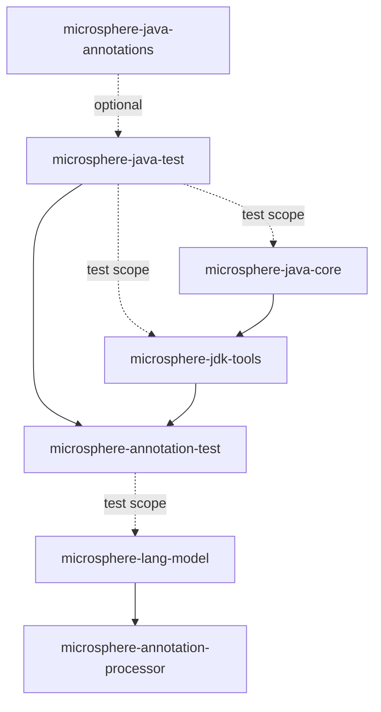
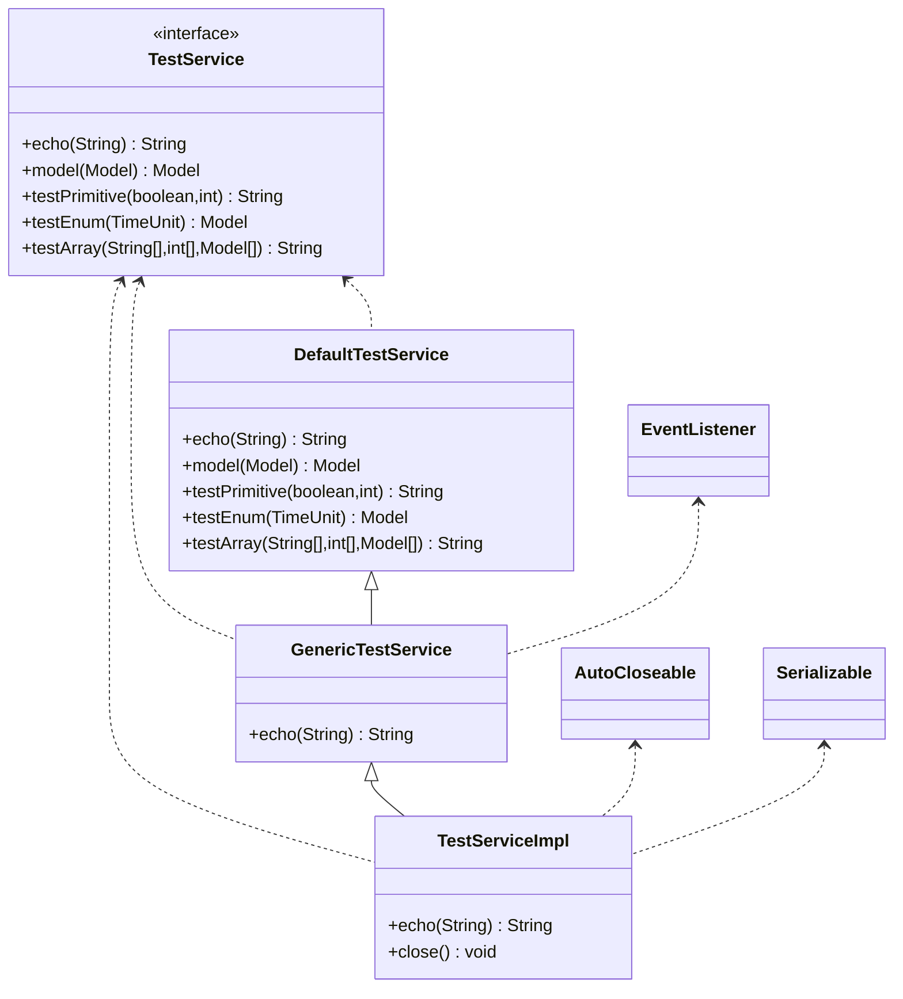

# Microsphere Java Test

| | |
|---|---|
| **构件** | `io.github.microsphere-projects:microsphere-java-test`（`0.3.20-SNAPSHOT`，`release` 分支） |
| **包** | `io.microsphere.test.annotation` (1 type) · `io.microsphere.test.model` (11 types) · `io.microsphere.test.service` (4 types) — 16 main-source types, no other code |
| **内容** | 1 annotation interface + 1 interface + 1 enum + 13 classes (one of them, `StringArrayList`, extends `ArrayList<String>`) = 16 types; 14 JUnit 5 test classes |
| **JDK 级别** | No `maven.compiler.*` / `<release>` property exists anywhere in the reactor — the bytecode level is inherited from the external parent `microsphere-build:0.3.16` (`pom.xml:6-10`); CI-tested on JDK 8 / 11 / 17 / 21 / 25 (Temurin) |
| **仓内编译依赖** | `io.github.microsphere-projects:microsphere-java-annotations`, declared `optional` (`microsphere-java-test/pom.xml:24-29`) |
| **其他声明的依赖** | `junit-jupiter`, `junit-jupiter-engine`, `mockito-core`, `logback-classic`, `javax.ws.rs-api`, `jaxws-api`, `spring-context`, `spring-web` — **every one `optional`, none with `<scope>test</scope>`** (`microsphere-java-test/pom.xml:31-84`) |
| **随包发布的资源** | `src/main/resources/junit-platform.properties`, `src/main/resources/logback-test.xml` — both land inside the jar and on consumers' test classpaths |

> [!NOTE]
> **本页使用的引用简写。** 模块源码的路径相对于 `microsphere-java-test/src/main/java/io/microsphere/`
> （`test/model/Model.java:29`），本模块自身的测试路径相对于 `microsphere-java-test/src/test/java/io/microsphere/`
> （`test/model/ModelTest.java:23`）。跨模块路径写全
> （`microsphere-java-core/pom.xml:66-71`）。

本模块是 Microsphere Java 的**共享夹具（fixture）层**。它发布十六个刻意写得平淡无奇的类型——一条 POJO 继承链、
一组"每个类型种类一个字段"的模型、一个枚举、一个反射用途的重负载注解，以及一小棵服务接口层次树——它们唯一的
职责就是给*其他*模块提供稳定且不平凡的反射、编译与注解处理目标。这里没有任何生产 API，也没有任何逻辑：每个方法
要么是 getter、要么是 setter，要么是一行的桩实现。

**当你需要……时选用这个构件**：为 Microsphere 自身（或复用其夹具的项目）编写测试，并且需要一个能够触发某条代码
路径的类型形状——用 `Model extends Parent extends Ancestor` 测试层级字段遍历，用 `CollectionTypeModel` 测试泛型
成分类型解析，用 `TestAnnotation` 测试跨全部八种成员类型的注解属性解析。加入这个 jar 在运行时应当零开销，因为它
的类型永远不会被生产代码加载。

---

## 1. 本模块的用途，以及谁在消费它

| 我想测试…… | 夹具 | 为什么用这个夹具 |
|---|---|---|
| 沿类层次向上遍历字段 | `test/model/Ancestor.java:27`, `test/model/Parent.java:25`, `test/model/Model.java:29` | Three-level chain `Model → Parent → Ancestor`, one field per level (`z` / `b,s,i,l` / `f,d,tu,str,bi,bd`) |
| 解析 primitive 类型字段 | `test/model/PrimitiveTypeModel.java:25` | All eight primitives, getters only — no setters (`test/model/PrimitiveTypeModel.java:43-73`) |
| 解析装箱/"simple" 类型（含 `Void`） | `test/model/SimpleTypeModel.java:29` | `Void`, `Boolean`, `Character`, …, `BigDecimal`, `BigInteger`, `java.util.Date` |
| 解析 `Collection` 泛型的成分类型 | `test/model/CollectionTypeModel.java:31` | `Collection<String>`, `List<Color>`, `Queue<PrimitiveTypeModel>`, `Deque<Model>`, `Set<Model[]>` |
| 解析 `Map` 泛型的键/值类型 | `test/model/MapTypeModel.java:31` | `Map`, `SortedMap`, `NavigableMap`, `HashMap`, `TreeMap` — declared types vary on purpose |
| 解析数组成分类型 | `test/model/ArrayTypeModel.java:25` | `int[]`, `String[]`, `PrimitiveTypeModel[]`, `Model[]`, `Color[]` |
| 一个参数化*父类型* | `test/model/StringArrayList.java:29` | `extends ArrayList<String>` — the type argument is fixed by inheritance, not by a field |
| 带状态的枚举常量 | `test/model/Color.java:25` | `RED(1)`, `YELLOW(2)`, `BLUE(3)` + `getValue()` + overridden `toString()` |
| 反射读取注解成员的值 | `test/annotation/TestAnnotation.java:43` | One attribute per supported member type (`test/annotation/TestAnnotation.java:45-71`) |
| 提取配置元数据 | `test/model/ConfigurationPropertyModel.java:29` | Five fields each carrying `@ConfigurationProperty(name = …)` |
| 接口 + 实现 + 代理解析 | `test/service/TestService.java:36`, `test/service/TestServiceImpl.java:77` | JAX-RS, Spring and JAX-WS annotations stacked on one type |

夹具之所以独立成模块、而不是复制进每个消费方的 `src/test`，有四个原因：

1. **同一个类型形状必须能从两个不同视角断言。** `microsphere-java-core` 在*运行时*反射这些类；
   `microsphere-lang-model` 与 `microsphere-annotation-processor` 在 `javac` 内部把*同一批*类当作
   `TypeElement`/`DeclaredType` 来检视。如果每个测试树里都有一份私有副本，这两个视图将无法互相比较。
2. **所有依赖都是 `optional`，因此消费方的版本胜出。** 本模块以 `optional` 方式请求 JUnit、Mockito、Logback、
   JAX-RS、JAX-WS 和 Spring（`microsphere-java-test/pom.xml:31-84`），这意味着它们一个都不会传递导出；消费方自己
   声明版本（`microsphere-lang-model/pom.xml:30-91`）。
3. **它把厚重的注解散布挡在生产构件之外。** 仅 `TestServiceImpl` 一个类就叠了 `@Service`、`@ServiceMode`、
   `@ComponentScans`、`@TestAnnotation` 和 `@Cacheable`（`test/service/TestServiceImpl.java:41-76`）；这些东西属于
   测试 jar，不属于 `microsphere-java-core`。
4. **Reactor 顺序已经把它排在消费方之前。** 它是第 6 个构建的模块（`pom.xml:63`，模块列表在 `pom.xml:58-66`），
   先于 `microsphere-annotation-test`（`:64`）、`microsphere-lang-model`（`:65`）和
   `microsphere-annotation-processor`（`:66`）。



> [!IMPORTANT]
> 从 `microsphere-java-test` 指向 `microsphere-annotation-test` 的那条边**不是** test 作用域。
> `microsphere-annotation-test` 声明这个依赖时完全没有 `<scope>` 元素
> （`microsphere-annotation-test/pom.xml:24-28`），即默认 `compile` 作用域。这是刻意为之：正是它让
> `microsphere-lang-model`（`microsphere-lang-model/src/test/java/io/microsphere/lang/model/util/TypeUtilsTest.java:19-28`）
> 和 `microsphere-annotation-processor` 中下游的测试代码能看到这些夹具，而不必各自重新声明
> `microsphere-java-test`。

---

## 2. 坐标

```xml
<dependency>
    <groupId>io.github.microsphere-projects</groupId>
    <artifactId>microsphere-java-test</artifactId>
    <version>0.3.20</version> <!-- newest published tag; 0.3.20-SNAPSHOT is this same line's working version -->
    <scope>test</scope> <!-- the scope every consumer in the reactor uses, except microsphere-annotation-test -->
</dependency>
```

| 字段 | 值 | 证据 |
|---|---|---|
| Group ID | `io.github.microsphere-projects` | `pom.xml:12` |
| Artifact ID | `microsphere-java-test` | `microsphere-java-test/pom.xml:14` |
| Version | `${revision}` = `0.3.20-SNAPSHOT` on `release` | `pom.xml:54`, `microsphere-java-test/pom.xml:15` |
| 在 reactor 中的位置 | 6th module built | `pom.xml:63` (modules `:58-66`) |
| Packaging | `jar` | `microsphere-java-test/pom.xml:16` |
| Name / description | `Microsphere :: Java :: Test` / `Microsphere Java Test` | `microsphere-java-test/pom.xml:18-19` |
| Parent | `microsphere-java-parent:${revision}` | `microsphere-java-test/pom.xml:5-10` |
| Build parent（祖父） | `microsphere-build:0.3.16` | `pom.xml:6-10` |
| 仓内依赖 | `microsphere-java-annotations`, `optional`, **no `<version>` element** — inherits `${revision}` | `microsphere-java-test/pom.xml:24-29` |
| 第三方版本的来源 | imported BOM `microsphere-all-bom:0.3.13` + `spring-framework-bom` | `microsphere-java-parent/pom.xml:22`, `:31-37`, `:39-46` |
| 可消费的 BOM | `microsphere-java-dependencies` manages this artifact | `microsphere-java-dependencies/pom.xml:42-46` |
| test 作用域的消费方 | `microsphere-java-core`, `microsphere-jdk-tools` | `microsphere-java-core/pom.xml:66-71`, `microsphere-jdk-tools/pom.xml:45-48` |
| compile 作用域的消费方 | `microsphere-annotation-test` | `microsphere-annotation-test/pom.xml:24-28` |

> [!WARNING]
> 请自己钉住版本。因为本模块的每个依赖都是 `optional`，本模块的 POM 关于消费方应当使用哪个 JUnit、Mockito 或
> Spring 一无所知；又因为这个构件*自身*的版本是 `${revision}`（`microsphere-java-test/pom.xml:15`），
> `microsphere-java-dependencies` 中的托管条目（`microsphere-java-dependencies/pom.xml:42-46`）也只带着
> `${revision}`。在 reactor 之外，请显式写出 `<version>0.3.20</version>`。

---

## 3. 版本信息与兼容性

| 事实 | 值 | 证据 |
|---|---|---|
| 发布线 | `release` branch | — |
| 工作版本 | `0.3.20-SNAPSHOT` | `pom.xml:54` |
| 最新已发布标签 | `0.3.20` | release notes / Maven Central |
| 声明的 `@since`（javadoc） | `1.0.0` on **all sixteen** main-source types | `test/annotation/TestAnnotation.java:38`, `test/model/Model.java:27`, `test/service/TestService.java:33`, `test/service/TestServiceImpl.java:39` |
| JDK 兼容性 | 8, 11, 17, 21, 25 (Temurin) | `.github/workflows/maven-build.yml:25`, `:33` |
| CI 使用的 Surefire 参数 | `-Dsurefire.useSystemClassLoader=false` | `.github/workflows/maven-build.yml:43` |
| Spring Framework 区间 | 5.3.39 on JDK `[1.8,17)` via profile `java8-16`; 7.0.9 otherwise | `microsphere-java-parent/pom.xml:23`, `:54-62` (activation `:57`) |
| 字节码级别 | Not set in this repository — inherited from `microsphere-build:0.3.16` | no `maven.compiler.*` / `<release>` property anywhere in the reactor |
| JAX-WS / JAX-RS 可用性 | `javax.*`（Java EE）命名空间，不是 `jakarta.*` | `test/service/TestService.java:21-26`, `test/service/TestServiceImpl.java:30` |

对于一个夹具模块，JDK 故事主要关于**哪些注解可以被读到**，因为这就是本模块所做的全部事情：

| 关注点 | JDK 8 | JDK 9 / 11 / 17 / 21 / 25 | 证据 |
|---|---|---|---|
| 反射 `Model` / `Color` / `TestService` | works | works | no JDK-internal API is referenced anywhere in the 16 files |
| `TestService` 上的 `javax.ws.rs.*` | needs `javax.ws.rs-api` | same | `microsphere-java-test/pom.xml:59-63`, `test/service/TestService.java:21-26` |
| `TestServiceImpl` 上的 `javax.xml.ws.ServiceMode` | needs `jaxws-api` | same | `microsphere-java-test/pom.xml:66-70`, `test/service/TestServiceImpl.java:30`, `:42` |
| `TestServiceImpl` 上的 Spring 注解 | needs `spring-context` | same, but the resolved Spring version switches at 17 | `microsphere-java-test/pom.xml:73-83`, `microsphere-java-parent/pom.xml:54-62` |
| 消费方 classpath 上**缺失** JAX-RS / JAX-WS / Spring | 夹具类仍能加载；对缺失的类型 `getAnnotations()` 返回空数组 | same | silent-missing-annotation behaviour — 见 §9 |

> [!TIP]
> 请把**optional 依赖清单**、而不是 JDK 版本，当作本模块的兼容性界面。如果你的测试断言 `TestServiceImpl` 携带
> `@Service`，那么你的构建也必须解析 `spring-context`；缺少它时夹具不会编译失败，它们只会报告更少的注解。

---

## 4. 注解族：`@TestAnnotation`

`TestAnnotation` 是本模块唯一的注解，它的存在理由是作为**注解成员值解析的覆盖率目标**——它为 Java 注解能够承载的
每一种值类型都声明了一个属性。

```java
@Retention(RUNTIME)
@Target(TYPE)
@Documented
public @interface TestAnnotation {

    boolean z() default false;

    char c() default 'a';

    byte b() default 1;

    short s() default 2;

    int i() default 3;

    long l() default 4L;

    float f() default 5.0f;

    double d() default 6.0d;

    String string() default "string";

    Class<?> type() default String.class;

    Class<?>[] types() default {String.class, Integer.class};

    TimeUnit timeUnit() default DAYS;

    Since since();

    ConfigurationProperty[] properties() default {};

}
```

| 属性 | 种类 | 默认值 | 行号 |
|---|---|---|---|
| `z` | `boolean` | `false` | `test/annotation/TestAnnotation.java:45` |
| `c` | `char` | `'a'` | `:47` |
| `b` | `byte` | `1` | `:49` |
| `s` | `short` | `2` | `:51` |
| `i` | `int` | `3` | `:53` |
| `l` | `long` | `4L` | `:55` |
| `f` | `float` | `5.0f` | `:57` |
| `d` | `double` | `6.0d` | `:59` |
| `string` | `String` | `"string"` | `:61` |
| `type` | `Class<?>` | `String.class` | `:63` |
| `types` | `Class<?>[]` | `{String.class, Integer.class}` | `:65` |
| `timeUnit` | enum-valued | `DAYS` | `:67` |
| `since` | **annotation-valued** | **none — you must supply it** | `:69` |
| `properties` | array-of-annotation | `{}` (empty) | `:71` |

这个声明有两个属性对消费方很重要：

- **保留策略是 `RUNTIME`，目标只有 `TYPE`**（`test/annotation/TestAnnotation.java:40-42`）。你可以用
  `getAnnotation(TestAnnotation.class)` 读取它，而 `microsphere-lang-model` 通过
  `assertElementTypes(TestAnnotation.class, TYPE)` 确认了目标集合
  （`microsphere-lang-model/src/test/java/io/microsphere/lang/model/util/AnnotationUtilsTest.java:714`）。
- **`since()` 没有默认值**（`test/annotation/TestAnnotation.java:69`），所以每个使用点都必须写出
  `since = @Since("1.0.0")`——参见模块内唯一的使用点 `test/service/TestServiceImpl.java:70`。这迫使嵌套注解的解析
  被真正执行到，而不是被跳过。

唯一那个真实使用点一次性写明了所有属性：

```java
@TestAnnotation(
        z = true,
        c = 'b',
        b = 1,
        s = 1,
        i = 1,
        l = 1,
        f = 1,
        d = 1,
        string = "testService",
        type = GenericTestService.class,
        types = {TestService.class, AutoCloseable.class, Serializable.class},
        timeUnit = HOURS,
        since = @Since("1.0.0"),
        properties = {
                @ConfigurationProperty(name = "key", type = String.class, defaultValue = "default-value", required = true, description = "description"),
                @ConfigurationProperty(name = "key2", type = Integer.class, defaultValue = "default-value2", required = true, description = "description2"),
                @ConfigurationProperty(name = "key3", type = Class.class, defaultValue = "default-value3", required = true, description = "description3")
        }
)
```

这个代码块（`test/service/TestServiceImpl.java:57-76`）正是 lang-model 测试当作注解值来采集的对象——
`getElementValues(super.testTypeElement, TestAnnotation.class)` 返回一个
`Map<ExecutableElement, AnnotationValue>`，在
`microsphere-lang-model/src/test/java/io/microsphere/lang/model/util/AnnotationUtilsTest.java:523`、`:532`、`:543`、
`:552`、`:567` 和 `:596` 处被使用。

---

## 5. 模型族：`io.microsphere.test.model`

十一个类型，分成三种角色。

**继承链**——`Ancestor`（`test/model/Ancestor.java:27`，`implements Serializable`，一个 `boolean z`）、
`Parent extends Ancestor`（`test/model/Parent.java:25`，`byte b`、`short s`、`int i`、`long l`）、
`Model extends Parent`（`test/model/Model.java:29`，`float f`、`double d`、`TimeUnit tu`、`String str`、
`BigInteger bi`、`BigDecimal bd`）。因此一个 `Model` 实例带有 11 个自身及继承字段，分布在三个类上：

```java
Model model = new Model();
assertEquals(0.0f, model.getF(), "float field f should be 0.0f by default");
assertNull(model.getTu(), "TimeUnit field tu should be null by default");
assertTrue(model instanceof Parent, "Model should extend Parent class");
```

取自本模块自身的测试 `test/model/ModelTest.java:29`、`:33`、`:84`。

**"每个类型种类一个字段"的模型**——`PrimitiveTypeModel`（`test/model/PrimitiveTypeModel.java:25`）与
`SimpleTypeModel`（`test/model/SimpleTypeModel.java:29`）刻意分为只读与可读写：`PrimitiveTypeModel`
**只暴露 getter**（`test/model/PrimitiveTypeModel.java:43-73`），因此任何假设存在 setter 的 bean 拷贝或注入工具
在这两个夹具上会表现出可观察的差异。`SimpleTypeModel` 是包装类型的目录，也是唯一携带"完全没有访问器"字段的模型
类型——`private int invalid`（`test/model/SimpleTypeModel.java:57`）。

**复合类型目录**——`ArrayTypeModel`（`test/model/ArrayTypeModel.java:25`）、`CollectionTypeModel`
（`test/model/CollectionTypeModel.java:31`）、`MapTypeModel`（`test/model/MapTypeModel.java:31`）和
`StringArrayList`（`test/model/StringArrayList.java:29`）。每个字段的声明原始类型都不同，源码中的注释记录了正在
测试哪一种元素种类：

```java
private Collection<String> strings; // 复合元素是 simple 类型

private List<Color> colors;     // 复合元素是 Enum 类型

private Queue<PrimitiveTypeModel> primitiveTypeModels;  // 复合元素是 POJO 类型

private Deque<Model> models;  // 复合元素是层级 POJO 类型

private Set<Model[]> modelArrays; // 复合元素是层级 POJO 类型
```

（`test/model/CollectionTypeModel.java:33-41`。）`MapTypeModel` 镜像了同样五种元素种类，但把其中两个字段的声明类型
写成了**具体类**，`HashMap<String, Model> models` 和 `TreeMap<PrimitiveTypeModel, Model[]> modelArrays`
（`test/model/MapTypeModel.java:39`、`:41`）——当消费方必须证明自己读取的是声明类型、而不是被拓宽成的接口类型时，
这一点就很有用。

**值承载者**——`Color`（`test/model/Color.java:25`）是一个带构造参数并覆写了 `toString()`
（`test/model/Color.java:37-42`）的枚举，这使它对反射式和 `javax.lang.model` 式读取者都不平凡。
`ConfigurationPropertyModel`（`test/model/ConfigurationPropertyModel.java:29`）是元数据夹具：

```java
@ConfigurationProperty(name = "microsphere.annotation.processor.model.name")
private String name;

@ConfigurationProperty(name = "microsphere.annotation.processor.model.type")
private Class<?> type;
```

（`test/model/ConfigurationPropertyModel.java:31-35`；其余三个字段在 `:37`、`:40`、`:43`，分别覆盖 `defaultValue`、
`required` 和 `description`。）它的属性名以 `microsphere.annotation.processor.…` 为前缀，这正是它为 processor 的
元数据输出而编写的迹象。

---

## 6. 服务族：`io.microsphere.test.service`

四个类型构成一个接口加一条三级实现梯。



- **`TestService`**（`test/service/TestService.java:36`）携带 JAX-RS 元数据：类型上的 `@Path("/echo")`（`:35`），
  五个方法上的 `@GET`/`@POST`/`@PUT`（`:38`、`:41`、`:45`、`:49`、`:53`）以及 `echo` 参数上的
  `@PathParam("message") @DefaultValue("mercyblitz")`（`:39`）。它还声明了一个**没有任何用途的方法级类型参数**：
  `<T> String echo(@PathParam("message") … String message)`（`:39`）——它回答的问题正是"我的类型解析器是否注意到了
  一个多余的类型变量？"
- **`DefaultTestService`**（`test/service/DefaultTestService.java:29`）是完整实现：`echo` 返回
  `"[ECHO] " + message`（`:34-36`），`model` 返回其入参（`:39-41`），而 `testPrimitive` / `testEnum` / `testArray`
  返回 `null`（`:44-46`、`:49-51`、`:54-56`）。
- **`GenericTestService`**（`test/service/GenericTestService.java:27`）继承 `DefaultTestService`，加上 `TestService`
  和 `java.util.EventListener` 接口，并且只覆写了 `echo`，方法体完全相同（`:28-31`）。有趣的部分是 `EventListener`
  这个标记接口——它让测试可以断言"检测到了标记接口"，而无需任何其他改动。
- **`TestServiceImpl`**（`test/service/TestServiceImpl.java:77`）继承 `GenericTestService` 并实现 `TestService`、
  `AutoCloseable` 和 `Serializable`，然后给自己叠上本模块全部的框架注解散布面：`@Service("testService")`（`:41`）、
  `@ServiceMode`（`:42`）、包含两个 `@ComponentScan` 条目（含 ASPECTJ 过滤器与 `scopedProxy = INTERFACES`）的
  `@ComponentScans`（`:43-56`）、`@TestAnnotation`（`:57-76`）、protected 字段上的 `@Autowired`（`:79-80`），以及
  `echo` 上的 `@Cacheable(cacheNames = {"cache-1", "cache-2"})`（`:93`）。

存在两个构造器，以便两种注入风格都能被测到：`TestServiceImpl()` 以 `null` 委托（`:84-86`），
`TestServiceImpl(@Autowired Environment environment)`（`:88-90`）。本模块自己的测试两者都用：

```java
testService = new TestServiceImpl(mockEnvironment);
testService.context = mockContext; // 注入被 mock 的 ApplicationContext
```

（`test/service/TestServiceImplTest.java:31-32`；`new TestServiceImpl()` 与 `assertNull(service.environment, …)`
的检查在 `:72-73`。）

`TestService` 同时是证明*层次展平*可行的那个夹具。从
`microsphere-lang-model/src/test/java/io/microsphere/lang/model/util/TypeUtilsTest.java:121-151` 可以看到期望的遍历
结果是字面量：

```java
private static final Type[] ALL_TYPES = ofArray(SELF_TYPE, SUPER_CLASS, DefaultTestService.class, Object.class, TestService.class, EventListener.class, AutoCloseable.class, Serializable.class);
```

（`TypeUtilsTest.java:131`，其中 `SELF_TYPE = TestServiceImpl.class` 在 `:121`，
`SUPER_CLASS = GenericTestService.class` 在 `:126`。）

---

## 7. 随包发布的资源

`src/main/resources` 恰好包含两个文件，二者都不在 `META-INF/services` 目录下：

```properties
junit.jupiter.extensions.autodetection.enabled = true
```

（`src/main/resources/junit-platform.properties:1`。）第二个是完整的 Logback 配置——
`src/main/resources/logback-test.xml`——它声明了一个写入 `test.log` 的 `FILE` appender
（`src/main/resources/logback-test.xml:5-12`）、一个包裹它的 `ASYNC`（`:14-16`）、一个 `STDOUT` 控制台 appender
（`:18-22`）、`root level="INFO"`（`:24-26`），以及一个名为 `io.microsphere`、级别 `TRACE` 且
`additivity="false"` 的专用 logger（`:28-30`）。

> [!WARNING]
> 这两个文件被打包进 jar，因此会到达每个消费方的 **test classpath**，而 `junit-platform.properties` 和
> `logback-test.xml` 在这条路径上都是按名字自动发现的。具体而言：依赖本模块会为你整个测试运行打开 JUnit 5 扩展
> 自动探测，并把 `io.microsphere` 钉在 `TRACE` 级别、写入一个异步的 `test.log` 文件。如何覆盖这两点见 §9。

本模块**不**发布任何属于自己的 `META-INF/services` 条目；reactor 中的 service loader 文件属于
`microsphere-java-core` 和 `microsphere-annotation-processor`。

---

## 8. 可运行示例

**A. 按 reactor 的方式声明依赖**（`microsphere-java-core/pom.xml:65-71`）：

```xml
<!-- Microsphere Java Test -->
<dependency>
    <groupId>io.github.microsphere-projects</groupId>
    <artifactId>microsphere-java-test</artifactId>
    <version>${revision}</version>
    <scope>test</scope>
</dependency>
```

**B. 对复合模型做反射。** lang-model 测试把夹具直接喂进一个已编译类集合
（`microsphere-lang-model/src/test/java/io/microsphere/lang/model/util/TypeUtilsTest.java:190-193`）：

```java
compiledClasses.add(ArrayTypeModel.class);
compiledClasses.add(CollectionTypeModel.class);
compiledClasses.add(Color.class);
compiledClasses.add(MapTypeModel.class);
```

然后对这些类断言类型种类谓词——`assertTrue(isEnumType(getDeclaredType(Color.class)))` 在
`TypeUtilsTest.java:272`，`assertFalse(isArrayType(getTypeElement(Color.class)))` 在 `:260`，
`assertTrue(isClassType(getTypeElement(ArrayTypeModel.class)))` 在 `:285`。

**C. 在测试中引用整条服务梯**（`TypeUtilsTest.java:25-28`，用在 `:121-151`）：

```java
import io.microsphere.test.service.DefaultTestService;
import io.microsphere.test.service.GenericTestService;
import io.microsphere.test.service.TestService;
import io.microsphere.test.service.TestServiceImpl;
```

**D. 元素种类混合的集合**——本模块自身测试用来构造夹具的模式
（`test/model/CollectionTypeModelTest.java:56-62`）：

```java
List<Color> testList = asList(RED, BLUE, YELLOW);

model.setColors(testList);
assertSame(testList, model.getColors(), "Should return the same list reference that was set");

// 校验内容一致
assertEquals(testList, model.getColors(), "List contents should match the set value");
```

`test/model/CollectionTypeModelTest.java:124-134` 走得更远，它把别名（aliasing）契约文档化了：在 `setColors` 之后
修改原来那个 `ArrayList`，通过 `getColors()` 仍然可见，因为 setter 存储的是引用本身
（`test/model/CollectionTypeModel.java:55-57`）。

**E. 通过注解处理测试装置消费 `@TestAnnotation`。** processor 的测试继承
`microsphere-annotation-test` 的基类，而该模块本身就是本构件 compile 作用域的消费方
（`microsphere-annotation-processor/src/test/java/io/microsphere/annotation/processor/ResourceProcessorTest.java:20`、
`FilerProcessorTest.java:20`、`ConfigurationPropertyAnnotationProcessorTest.java:20`、
`ConfigurationPropertyJSONElementVisitorTest.java:26`）。

---

## 9. 常见陷阱

1. **把本模块的 `io.microsphere.test.*` 与 core 的 `io.microsphere.test` 包混为一谈。**
   `microsphere-java-core/src/test/java/io/microsphere/test/` 装的是另一套毫无关系、数量大得多的夹具——`A`、`B`、
   `C`、`D`、`E`、`Data`、`MultipleValueData`、`StringIntegerHashMap`、`StringBF2`……（例如
   `microsphere-java-core/src/test/java/io/microsphere/reflect/TypeUtilsTest.java:22-29` 和
   `microsphere-java-core/src/test/java/io/microsphere/json/JSONUtilsTest.java:22-27` 处的 import）。这些类**不在**
   本构件里。如果 `import io.microsphere.test.Model;` 失败，那是你猜错了包——本模块的模型类型在
   `io.microsphere.test.model` 之下。
2. **指望 JUnit/Mockito/Spring 会传递进来。** 每个依赖都是 `optional`
   （`microsphere-java-test/pom.xml:31-84`），按 Maven 语义这会抑制传递性。只依赖 `microsphere-java-test`
   **不会**把 `junit-jupiter` 放上你的 test classpath；你必须自己声明它，正如 `microsphere-lang-model` 所做的那样
   （`microsphere-lang-model/pom.xml:31-41`）。
3. **免费得到了 Logback 与扩展自动探测。** 见 §7 中的警告——`src/main/resources/logback-test.xml` 和
   `src/main/resources/junit-platform.properties` 都随 jar 发布并按名字被发现。如果你的项目已经有
   `logback-test.xml`，由 classpath 顺序决定哪个生效；如果你不想要自动探测，请在你自己的
   `src/test/resources/junit-platform.properties` 中设置
   `junit.jupiter.extensions.autodetection.enabled=false`。
4. **假定夹具就是可变的 JavaBean。** `PrimitiveTypeModel` 没有 setter
   （`test/model/PrimitiveTypeModel.java:43-73`），`SimpleTypeModel.invalid` 两个访问器都没有
   （`test/model/SimpleTypeModel.java:57`）。通过 `java.beans` 属性描述符自省的那些 `z`,`b`,`c`,`s`,`i`,`l`,`f`,`d`
   在这里会被发现为只读。
5. **通过接口去绑定 `Map`/`Collection` 字段。** `MapTypeModel.getModels()` 返回 `HashMap`，
   `getModelArrays()` 返回 `TreeMap`（`test/model/MapTypeModel.java:67`、`:75`）——一个按 `Map<K,V>` 接口来解析的消费方
   会漏掉 `microsphere-lang-model/src/test/java/io/microsphere/lang/model/util/TypeUtilsTest.java:190-193` 中实际使用的
   那些具体声明类型。
6. **`TreeMap<PrimitiveTypeModel, …>` 没有可用的键序。** `PrimitiveTypeModel` 没有实现 `Comparable`，也什么都没覆写
   （`test/model/PrimitiveTypeModel.java:25-74`），所以要往 `MapTypeModel.modelArrays`
   （`test/model/MapTypeModel.java:41`）里放真实 `TreeMap` 条目，必须提供外部 `Comparator`。这个夹具只携带*类型*，
   从不携带实例。
7. **忘了 `since` 是必填的。** `test/annotation/TestAnnotation.java:69` 声明的 `Since since();` 没有默认值，所以给你
   自己的类加 `@TestAnnotation` 时会编译失败，直到你写出 `since = @Since("…")`——对比
   `test/service/TestServiceImpl.java:70`。
8. **框架注解会静默缺失。** 如果 `spring-context` 没有被解析，
   `TestServiceImpl.class.getAnnotations()` 只会简单地不含 `@Service`，而不是报错
   （`microsphere-java-test/pom.xml:73-77`）。请只对你确实声明了依赖的注解做断言。
9. **`@ServiceMode` 在这里不携带任何属性值**（`test/service/TestServiceImpl.java:42`），与该类上其他注解不同。如果你的
   断言会遍历注解的*成员*值，这一个贡献零个条目——这是一个正当的夹具场景，不是你代码的 bug。

> [!TIP]
> 新增夹具时，优先在**既有族里加新类型**，而不是扩展既有类型。`Model`、`CollectionTypeModel` 等一批类被
> `microsphere-java-core` 和 `microsphere-lang-model` 以字面量形式硬编码进期望值数组；改动它们的形状会在另一个模块里
> 破坏那些断言，而不是在你编辑的这个模块里。

---

## 10. 另见

* [用户指南索引](README.md)
* 本页英文版：[English User Guide](../microsphere-java-test.md)
* 本模块的开发者指南：[microsphere-java-test —— 开发者指南](../../developer-guide/zh/microsphere-java-test.md)
* [microsphere-java-annotations](../zh/microsphere-java-annotations.md) —— 发布 `@Since` 与 `@ConfigurationProperty`，
  即 `@TestAnnotation` 所嵌入的两个注解（`test/annotation/TestAnnotation.java:20-21`、`:69`、`:71`）
* [microsphere-annotation-processor](../zh/microsphere-annotation-processor.md) —— `ConfigurationPropertyModel` 的编译期读取者
* [microsphere-lang-model](../zh/microsphere-lang-model.md) —— 模型与服务夹具的最大消费方
* [microsphere-jdk-tools](../zh/microsphere-jdk-tools.md) —— test 作用域消费方（`microsphere-jdk-tools/pom.xml:45-48`）
* core 模块页面：[microsphere-java-core 子包索引](../microsphere-java-core/zh/README.md)
