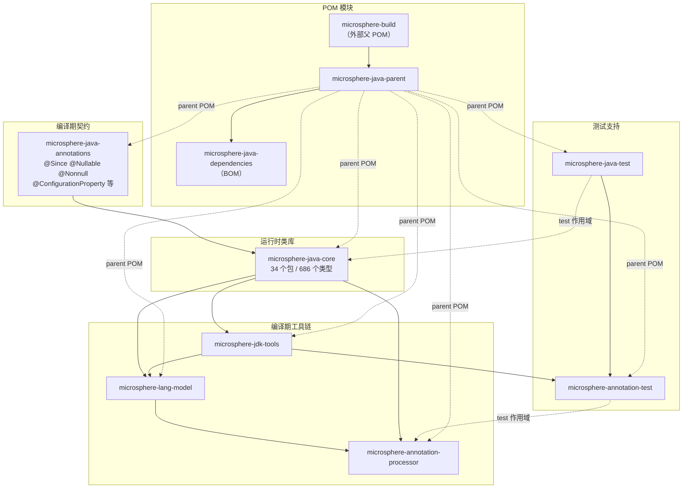

# Microsphere Java 文档

[`microsphere-java`](https://github.com/microsphere-projects/microsphere-java) 的文档目录。该库是一套 Java 基础设施类库，
提供空安全工具、反射与类型抽象、转换/序列化 SPI、事件分发、I/O 与 classpath 扫描、自定义 URL 协议、日志门面、
构件探测、JSON 支持、配置属性元数据，以及一整套编译期注解处理链。

文档按 **Maven 模块** 组织，并按 **文档分支线**（即文档所对应的源码分支）分目录存放；每个页面都有英文与中文两个版本。

---

## 1. 选择指南

| 指南 | 面向读者 | 英文 | 中文 |
|------|----------|------|------|
| **用户文档** | 库的使用者：依赖什么、调用哪些 API、支持哪些 JDK | [current/user-guide/zh/README.md](current/user-guide/zh/README.md) | 即本页链接的中文入口 |
| **开发者文档** | 库的维护者与框架作者：架构设计、源码分析、设计模式、流程图 | [current/developer-guide/zh/README.md](current/developer-guide/zh/README.md) | 即本页链接的中文入口 |

---

## 2. 版本线

每个文档子目录对应一条长期维护的源码分支。页面内容（API 签名、SPI 注册项、JDK 兼容性结论）均取自该分支，而不是 `main`。

| 目录 | 源码分支 | 版本 | 状态 |
|------|----------|------|------|
| [`current/`](current/user-guide/zh/README.md) | `release` | `0.3.20-SNAPSHOT`（最新已发布标签：`0.3.19`） | 使用中 |
| `1.x/` | `release-1.x` | — | 未生成：本仓库不存在 `release-1.x` 分支；该分支建立后按相同布局创建 `docs/1.x/` 即可。 |

---

## 3. 覆盖的模块

每个 Maven 模块一篇文档；`microsphere-java-core` 由于体量较大（686 个源文件、34 个包），按顶层包分组拆成 14 篇。

| Maven 模块 | 类型 | 依赖 | 用户文档 | 开发者文档 |
|------------|------|------|----------|------------|
| `microsphere-java-annotations` | jar | 无（`jsr305` 为 optional） | [页面](current/user-guide/zh/microsphere-java-annotations.md) | [页面](current/developer-guide/zh/microsphere-java-annotations.md) |
| `microsphere-java-core` | jar | annotations | [14 篇](current/user-guide/microsphere-java-core/zh/README.md) | [14 篇](current/developer-guide/microsphere-java-core/zh/README.md) |
| `microsphere-jdk-tools` | jar | core | [页面](current/user-guide/zh/microsphere-jdk-tools.md) | [页面](current/developer-guide/zh/microsphere-jdk-tools.md) |
| `microsphere-lang-model` | jar | core | [页面](current/user-guide/zh/microsphere-lang-model.md) | [页面](current/developer-guide/zh/microsphere-lang-model.md) |
| `microsphere-annotation-processor` | jar（shade 打包） | core、lang-model | [页面](current/user-guide/zh/microsphere-annotation-processor.md) | [页面](current/developer-guide/zh/microsphere-annotation-processor.md) |
| `microsphere-java-test` | jar（测试夹具） | annotations（依赖全部 optional） | [页面](current/user-guide/zh/microsphere-java-test.md) | [页面](current/developer-guide/zh/microsphere-java-test.md) |
| `microsphere-annotation-test` | jar（测试框架） | java-test、jdk-tools | [页面](current/user-guide/zh/microsphere-annotation-test.md) | [页面](current/developer-guide/zh/microsphere-annotation-test.md) |
| `microsphere-java-parent` | pom | 外部 `microsphere-build` | 不单独成文，构建约定见各篇的「版本信息」小节 |
| `microsphere-java-dependencies` | pom（BOM） | — | 不单独成文，其 `dependencyManagement` 条目在[快速开始](current/user-guide/zh/README.md)中列出 |

---

## 4. 模块依赖关系

实线为 compile 作用域依赖，虚线为 test 作用域、optional 或 POM 继承关系。
该图由各模块 `pom.xml`（`release` 分支）的 `<dependencies>` 段落推导而来。

---

## 5. 语言与目录布局

* **英文为默认语言**，位于主路径（`docs/current/user-guide/foo.md`）。
* **中文**独立存放：同名文件镜像在同一个目录下的 `zh/` 子目录中（`docs/current/user-guide/zh/foo.md`）。
* 本索引的英文版：[README.md](README.md)。

---

## 6. 附录：按主题组织的手册

在上述按模块组织之前，文档曾按 18 个功能主题编排（快速开始、核心工具、反射与类型……）。这套双语主题手册仍然保留，
适合作为横向阅读材料，但它**不是**按模块组织、也不按版本分支区分：

* 用户主题手册：[user-guide/README.md](user-guide/README.md)
* 开发者主题手册：[developer-guide/README.md](developer-guide/README.md)（英文在 `developer-guide/en/`，中文在 `developer-guide/zh/`）

---

## 7. 阅读顺序

1. 先读[用户文档索引](current/user-guide/zh/README.md)：其中给出 Maven 坐标、JDK 兼容矩阵与「我该看哪一篇」的对照表。
2. 若要在库上做扩展，先读[开发者文档索引](current/developer-guide/zh/README.md)了解架构与 SPI 清单，再进入具体模块页面。
3. 页面中的事实均来自 `release` 分支源码。若文档与代码不一致，以代码为准。
